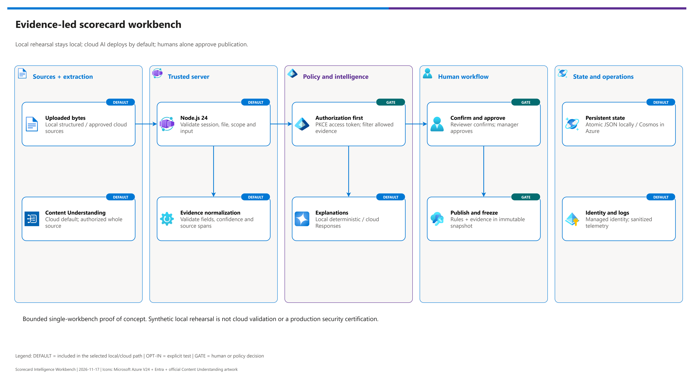
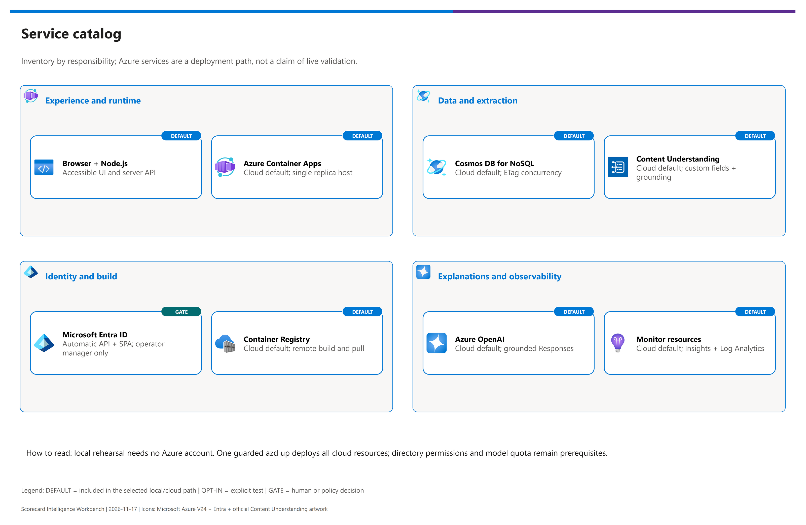

# Scorecard Intelligence Workbench

<p>
&nbsp;
&nbsp;
&nbsp;
&nbsp;
&nbsp;

</p>

   

A runnable, evidence-led proof of concept for teams that review periodic measurements from uploaded documents. Extract real text and cells, reconcile uncertain records, ask evidence-grounded questions, approve draft follow-ups, and publish an immutable period snapshot. Local rehearsal uses synthetic files and deterministic answers. Azure deployment enables Content Understanding extraction and model-backed explanations by default.

> [!IMPORTANT]
> The default is **local synthetic rehearsal**, not an LLM and not an Azure deployment. No customer corpus, scanned-document quality target, production security certification, or live Azure deployment is claimed.

> [!CAUTION]
> Content Understanding custom extraction is model processing of the **whole submitted source**, not just OCR. Submit only separately authorized documents. Known detectable restrictions are rejected before the call; detecting restricted text only in the result cannot undo its disclosure to extraction models. No arbitrary scanned/mixed-document automatic redaction is claimed.

## At a glance

| | Question | Answer |
|---|---|---|
|  | What enters? | Actual PDF text, XLSX, CSV, TXT and JSON bytes; scans require optional Azure extraction. |
|  | Who decides? | Reviewer confirms records; manager approves actions and periods, then publishes. Auditor is read-only. |
|  | Who computes status? | Configured deterministic thresholds, never a language model. |
|  | Where is access enforced? | On the server, before state, citations, aggregates and answer inputs are built. |
|  | What persists? | Atomic JSON locally; Cosmos DB for NoSQL with optimistic ETags in Azure. |

## What this pattern delivers

[](./docs/assets/scorecard-intelligence-workbench-architecture.png)

<sub>Editable source: [reference architecture](./docs/assets/scorecard-intelligence-workbench-architecture.drawio). Regenerate PNGs with `python scripts/export_diagrams.py docs/assets`.</sub>

The workbench keeps the evidence chain visible: source bytes → extracted record → correction and confirmation → deterministic status → approved period → frozen history. Answers contain stable evidence IDs and page, sheet/cell or row locations where available. Missing or unsupported evidence produces an explicit abstention rather than a plausible answer.

Draft follow-ups are an open-points list: suggestions remain drafts until a human manager approves them. The application does not send messages, assign work to guessed people, modify source files, or automatically publish a period. A correction invalidates prior confirmation and period approval.

## Quick start

| Step | | Run from the repository root | Checkpoint |
|---|---|---|---|
| **1** |  | Install Node.js 24 or newer; run `npm ci` | Locked dependencies installed. |
| **2** |  | `npm run samples` | Synthetic source documents generated. |
| **3** |  | `pwsh -File scripts/start-local.ps1 -Port 3000` | Open `http://127.0.0.1:3000`; `/health` returns `ok`. |
| **4** |  | Select a local role and load the sample scenario | Provider labels say local; review actual evidence. |
| **5** |  | `npm test` and `npm run evaluate` | Read measured fixture results and limitations. |

### Deploy the complete demo to Azure (recommended)

Install Azure CLI, Azure Developer CLI, PowerShell 7 and Node.js 24+. From this repository's root, run:

```powershell
azd up
```

On the first run, supply an environment name, your **explicit demo tenant and subscription**, and a region (`swedencentral` is the default). The bootstrap verifies both CLI contexts and signs in to the selected tenant if needed; it never silently adopts an ambient account.

The command orchestrates the entire default cloud stack: Container Apps, remote container build/registry, Cosmos DB, managed identity/RBAC, logs, **Content Understanding plus completion and embedding deployments**, **Azure OpenAI answers**, and the custom analyzer. It also creates/reuses the demo's API/SPA registrations, scope, roles and service principals, grants only the current operator the demo's manager role, and registers the deployed sign-in callback. No client secret or tenant-wide consent grant is created.

Open the application URL shown at completion (`appUrl` in ignored `demo-ids.local.json`) and sign in. Your subscription must have suitable model quota and Azure deployment/RBAC permissions, and your account must be allowed to create applications and assign the demo app role. The command does not bypass those requirements or switch regions silently. Full permissions, adjustable model defaults, verification and teardown: [Deployment](./docs/03-deployment.md) and [Configuration](./docs/08-configuration-reference.md).

### Azure CLI alternative (no azd required)

The Azure CLI-backed script prompts for the same target settings and uses the same Bicep, identity bootstrap and default AI resources:

```powershell
.\scripts\deploy.ps1
```

Cloud AI can be explicitly disabled with `DEPLOY_CONTENT_UNDERSTANDING=false` or `DEPLOY_OPENAI=false`; `AUTO_CONFIGURE_ENTRA=false` uses existing, manually configured registrations. Local rehearsal remains local and does not provision anything. If templates are prohibited, use the [Portal and imperative CLI deployment](./docs/03b-manual-deployment.md).

**Upgrading an existing azd environment:** previous explicit opt-outs are preserved. Re-enable the complete stack before redeploying:

```powershell
azd env set DEPLOY_CONTENT_UNDERSTANDING true
azd env set DEPLOY_OPENAI true
azd up
```

Directory application registrations are outside the Azure resource group: `azd down` does not delete them. Follow the documented explicit identity cleanup when retiring the demo.

> [!WARNING]
> Keep local authentication on loopback. Never expose the local role selector as cloud authentication. Azure requires validated Microsoft Entra access tokens and configured application roles.

## Choose a path

| Criterion | Local rehearsal | Azure deployment | Recommendation |
|---|---|---|---|
| Authentication | Server-issued synthetic role cookie | Entra JWT validation | Use local only on a trusted workstation. |
| Persistence | Atomic JSON, single process | Cosmos DB, managed identity | Azure for restart-persistent hosted evaluation. |
| Extraction | Real embedded PDF text and structured-file parsers | Default Content Understanding custom field schema, confidence and source grounding; XLSX/CSV/JSON still parse locally | Authorize the whole source before cloud model processing; validate every field and keep human review. |
| Answers | Deterministic evidence renderer | Default Azure OpenAI Responses | Compare the same authorized evidence and test abstention. |
| Operations | No Azure spend | Container, database, logs and AI cost | Start local; agree a budget before cloud provisioning. |
| Validation | Reproducible small synthetic fixtures | Must be run in your environment | Do not transfer fixture results into customer-quality claims. |

Local validation on **2026-11-17**: the latest full suite passed **66/66 Node tests**, including default-cloud orchestration and managed identity-registration coverage. The earlier same-day **10/10 Edge browser tests**, **3/3 Python documentation tests** and **23/23 synthetic evaluation checks** (`fixtureOnly=true`) remain documented; the three Python checks also passed after this deployment update. Browser evidence came from the real local rehearsal, including unit-correction coverage. Azure, Graph, OAuth and Content Understanding requests in automated coverage are mocked, not a live deployment. See [Testing](./docs/04-testing.md#actual-local-fixture-snapshot--2026-11-17) for the fixture scope and limitations, separately from live validation.

## What's inside

<table>
<tr>
<td align="center"><br><b>Runtime</b><br>Node.js server + accessible browser UI</td>
<td align="center"><br><b>Evidence</b><br>Schema fields, confidence, source grounding</td>
<td align="center"><br><b>Controls</b><br>Server roles + human publication</td>
<td align="center"><br><b>History</b><br>Persistent approved snapshots</td>
</tr>
</table>

[](./docs/assets/service-catalog.png)

<sub>Editable source: [service catalog](./docs/assets/service-catalog.drawio). Icons are local, official Microsoft artwork; see [attribution](./docs/assets/icons/README.md).</sub>

## Reading and running order

| Document | What you can accomplish |
|---|---|
| [00 Reproduce](./docs/00-reproduce-this-demo.md) | End-to-end checkpoints and honest evidence boundaries. |
| [01 Architecture](./docs/01-architecture.md) | Locked decisions, trust boundaries and configuration-only adaptation. |
| [02 Prerequisites](./docs/02-prerequisites.md) | Tools, identity, region, RBAC and budget readiness. |
| [03 Deployment](./docs/03-deployment.md) | Tenant-explicit `azd up` over shared Bicep. |
| [03b Manual deployment](./docs/03b-manual-deployment.md) | Equivalent Portal and CLI resource creation. |
| [04 Testing](./docs/04-testing.md) | Functional, authorization, fixture-quality and cloud validation. |
| [05 Troubleshooting](./docs/05-troubleshooting.md) | Symptom-led diagnosis without disabling controls. |
| [06 Why this design](./docs/06-why-this-design.md) | Forwardable decision narrative and feasibility gaps. |
| [07 Presenter walkthrough](./docs/07-presenter-walkthrough.md) | A scripted story with expected outcomes and proof. |
| [08 Configuration](./docs/08-configuration-reference.md) | Every setting, output, domain field and operational knob. |

All narrative runbooks live under `docs/`. Application code is under `app/`, generated inputs under `samples/`, deployment templates under `infra/`, and checks under `tests/`. The editable diagram sources and offline artwork are under `docs/assets/`.

## Distribution

| Item | Distribution rule |
|---|---|
| Source, lockfile, tests, Bicep and docs | Keep together in your GitHub or Azure DevOps repository. |
| `demo-ids.template.json` | Commit neutral defaults; copy locally before customization. |
| `demo-ids.local.json`, `.azure/`, runtime state and populated IDs | Never commit; review `.gitignore` before pushing. |
| Credentials and tokens | Never commit or paste into evidence screenshots; use managed identity in Azure. |
| Runtime documents | Synthetic only for this reference; apply your own retention and access review before using organizational data. |

This is a bounded proof of concept, not a production reference implementation. Hosted browser sign-in uses an explicitly configured Entra SPA authorization-code/PKCE flow; it has not been validated against a live tenant. Production identity-library integration, multi-workbench isolation, enterprise retention, private networking, malware scanning, durable background extraction and large-file external storage need explicit design work.

## Decision provenance

| Public artifact | Purpose |
|---|---|
| [Architecture locked decisions](./docs/01-architecture.md#locked-decisions) | Baseline and rationale. |
| [Design trade-offs](./docs/06-why-this-design.md) | Recommendations and limitations. |
| [Change log](./CHANGELOG.md) | Publication-date verification notes. |
| [Testing and evidence](./docs/04-testing.md) | Actual run commands, measurements and unvalidated paths. |

Next: [Reproduce this demo](./docs/00-reproduce-this-demo.md).

*Last updated: 2026-11-17*
