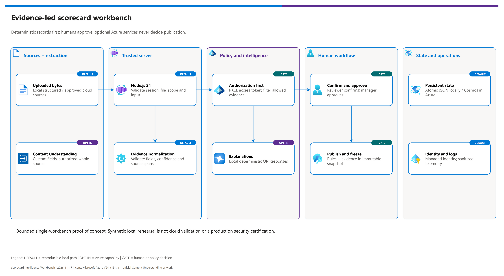

[README](../README.md) › Reproduce this demo

# 00 — Reproduce this demo

<p>
&nbsp;
&nbsp;
&nbsp;

</p>

  

This is the end-to-end operator checklist for reproducing a bounded document-to-review proof of concept. It starts with real generated synthetic files on your workstation, then offers an optional cloud deployment. Follow the gates in order: a green health endpoint is not proof of correct extraction, authorization or publication behavior.

## At a glance

| | Outcome | Evidence to retain |
|---|---|---|
|  | Source-to-record traceability | Original synthetic file and page/cell/row citation. |
|  | Reproducible status | Configured threshold rules and version in published snapshot. |
|  | Human-controlled release | Confirmation, manager approval and immutable publication. |
|  | Persistent rehearsal | Records survive restart; conflict tests reject stale changes. |

> [!NOTE]
> Default answers are a deterministic local evidence renderer. They are useful for repeatable interaction tests, but do not evaluate a language model or OCR.

## End state

[](./assets/scorecard-intelligence-workbench-architecture.png)

<sub>Editable source: [architecture](./assets/scorecard-intelligence-workbench-architecture.drawio).</sub>

```text
Synthetic files --> real local text/cell extraction --> review queue
                                                           |
                       authorized evidence --> answer <---+
                                                           |
                              confirm --> approve --> publish/freeze
                                                           |
                                     atomic JSON / optional Cosmos DB
```

The source is not an answer fixture. Loading samples generates or reads file bytes and sends them through extraction. A record retains its raw value, normalized numeric value, configured KPI mapping, unit, source location and uncertainty signal. The review queue is where ambiguous results are corrected, not where uncertain input is hidden.

## Time budget and stop conditions

| | Part | First run planning allowance | Repeat run | Gate |
|---|---|---|---|---|
|  | A — Tooling | 15–30 minutes | A few minutes | Supported runtime and locked install. |
|  | B — Local rehearsal | 20–40 minutes | 10–20 minutes | Source evidence and role checks. |
|  | C — Measurements | 15–30 minutes | 5–15 minutes | Actual fixture output reviewed. |
|  | D — Cloud readiness | Organization dependent | Recheck every target | Tenant, access, quota and app roles agreed. |
|  | E — Cloud deployment | Allow a separate workshop session | Environment dependent | Cloud tests, not just provisioning. |
|  | F — Present and clean up | 20–30 minutes | 15 minutes | Claims and evidence match. |

These are planning estimates, not measured deployment timings or service guarantees. Stop before Part D if you only need a local proof. Stop cloud work if the target or application identity has not been explicitly supplied.

## Part A — Prepare a clean local run

| Step | | Action | Checkpoint |
|---|---|---|---|
| **A1** |  | Run `node --version` and `npm --version` | Node.js is at least 24. |
| **A2** |  | Open a terminal in the cloned repository | `package.json` and `app/` share this root. |
| **A3** |  | Run `npm ci` | Install uses the committed lockfile. |
| **A4** |  | Optionally copy `demo-ids.template.json` to `demo-ids.local.json` | No populated IDs or credentials added to tracked files. |

<details><summary><b>Local commands</b></summary>

```powershell
node --version
npm ci
Copy-Item demo-ids.template.json demo-ids.local.json
npm run samples
$env:AUTH_MODE = 'local'
$env:HOST = '127.0.0.1'
$env:PORT = '3000'
$env:EXTRACTION_PROVIDER = 'local'
$env:ANSWER_PROVIDER = 'local'
$env:STATE_PROVIDER = 'local'
npm start
```

Skip the copy if a reviewed local configuration already exists. The copy is not necessary for the neutral default scenario.

</details>

Checkpoint: open `http://127.0.0.1:3000/health`, then the application root. The health endpoint should respond with `{"status":"ok"}`. This says only that the server is listening.

## Part B — Prove the review lifecycle

| Step | | Action | Checkpoint |
|---|---|---|---|
| **B1** |  | Establish a local reviewer session; load the synthetic scenario | Session and provider labels are visible. |
| **B2** |  | Open an extracted source and compare a value | Page, sheet/cell or CSV row matches actual bytes. |
| **B3** |  | Correct a record and confirm it | Status recomputes deterministically; correction clears prior confirmation. |
| **B4** |  | Ask a supported question, then an unsupported one | Grounded answer has citations; unsupported request abstains. |
| **B5** |  | Manager approves the period and publishes | Only confirmed applicable records qualify. |
| **B6** |  | Try to edit a published record | Server rejects the change; snapshot remains unchanged. |

Do not silently remove difficult rows to obtain approval. Investigate missing values, unit mismatch, multilingual aliases or decimal commas first. A confirmation is a human assertion about that source record, not a calibrated model-accuracy score.

## Part C — Measure instead of guessing

<details><summary><b>Reproducible local checks</b></summary>

```powershell
npm test
npm run evaluate
npm run test:browser
python -m unittest discover -s tests -p test_doc_visuals.py
python scripts/lint_doc_visuals.py --strict
python scripts/export_diagrams.py docs/assets --check
```

If Edge is unavailable, choose an installed supported browser with `PLAYWRIGHT_CHANNEL`; see the test configuration before running. A failed dependency/browser installation is an environment failure, not a passing application test.

</details>

Use the [testing runbook](./04-testing.md) to classify failures and record actual counts. Do not copy proposed starting targets into a results column. Tiny generated fixtures test known cases; they cannot establish production accuracy across unseen layouts, scans or languages.

## Part D — Decide whether Azure is needed

| Requirement | Local path | Azure path | Recommendation |
|---|---|---|---|
| Embedded PDF text and spreadsheet review | Available | Same workflow | Prove local first. |
| Varied layouts, scanned pages and cloud-supported document variants | Local implemented text/structured parsing only | Optional Content Understanding custom fields, confidence and source grounding | Authorize whole sources for model processing; add per-variant annotated evaluation and human review. |
| Model explanations | Deterministic only | Explicit Responses provider | Validate the deployment and output rejection. |
| Hosted persistence | Workstation file | Cosmos DB | Complete app roles and restart test. |

> [!WARNING]
> Do not run deployment or token commands without a confirmed tenant and subscription. No cloud login or deployment was performed to author this reference.

Cloud checklist: [prerequisites](./02-prerequisites.md) → [deployment](./03-deployment.md) or [manual equivalent](./03b-manual-deployment.md) → [cloud validation](./04-testing.md#live-validation).

## Part E — Deploy and verify the same application

| Step | | Action | Checkpoint |
|---|---|---|---|
| **E1** |  | Authenticate both CLIs to the explicit target | Tenant and subscription match the reviewed values. |
| **E2** |  | Preview shared Bicep and run `azd up` |  Foundation, image build and revision complete when run. |
| **E3** |  | Use valid role-bearing API tokens | Wrong tenant/audience/role and local login are denied. |
| **E4** |  | Restart the revision after a synthetic change | Cosmos state persists and conflicts remain protected. |

Keep Azure AI disabled until baseline identity and state tests pass. Enable extraction and answers independently so a failing model call cannot disguise a parsing or authorization defect.

## Part F — Present, retain evidence and clean up

| Step | | Action | Checkpoint |
|---|---|---|---|
| **F1** |  | Follow the [script](./07-presenter-walkthrough.md) | Declare local versus Azure at the start. |
| **F2** |  | Keep sanitized fixture results and screenshots | No bearer tokens, private data or populated identifiers. |
| **F3** |  | Remove disposable cloud resources after approval | Check database retention and unrelated resources first. |

Next: [Architecture](./01-architecture.md).

*Last updated: 2026-11-17*
