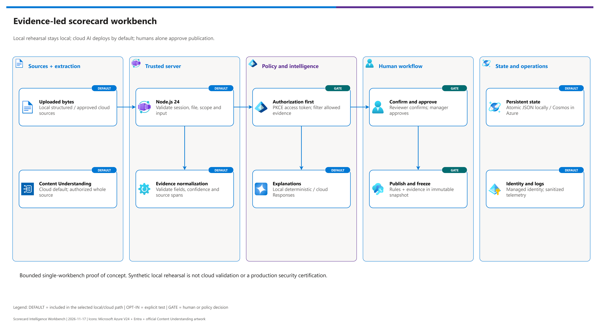
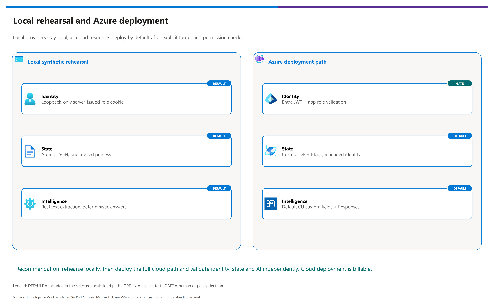
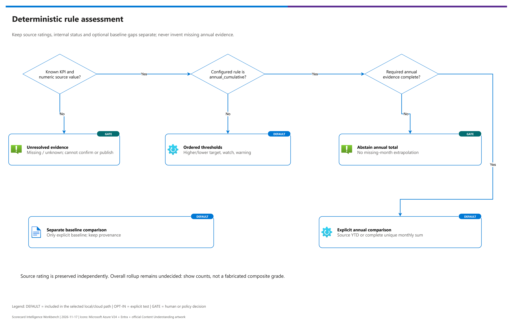
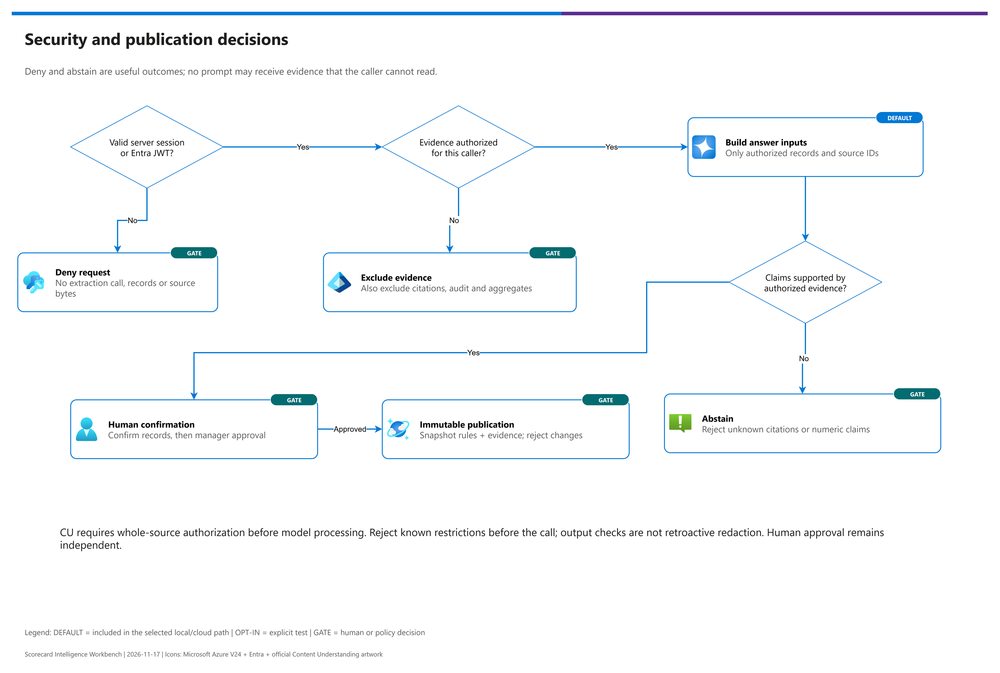

[README](../README.md) › [Reproduce](./00-reproduce-this-demo.md) › Architecture

# 01 — Architecture

<p>
&nbsp;
&nbsp;
&nbsp;
&nbsp;

</p>

  

This reference describes a bounded, single-workbench application for evidence-led review of periodic measurements. It is for implementers and reviewers who need to distinguish deterministic business decisions, human authority and default cloud model assistance. Local rehearsal remains deterministic and local. The design prioritizes inspectable sources and denial behavior over an impressive but unverifiable answer.

## At a glance

| | Decision | Consequence |
|---|---|---|
|  | Node.js 24 ESM with built-in HTTP server | One application serves API and browser assets. |
|  | Extract from actual uploaded bytes | No hand-authored result fixture masquerades as ingestion. |
|  | Confirm → approve → publish | Model output never publishes or changes a threshold. |
|  | Server authorization before answer construction | Restricted content cannot be removed only after generation. |

## Reference architecture

[](./assets/scorecard-intelligence-workbench-architecture.png)

<sub>Editable source: [architecture](./assets/scorecard-intelligence-workbench-architecture.drawio). Export with `python scripts/export_diagrams.py docs/assets`.</sub>

| Tier | Component | Responsibility |
|---|---|---|
| Source |  Uploaded/generated files | Actual PDF/XLSX/CSV/TXT/JSON bytes, scoped to one entity and period. |
| Ingestion |  Local parsers / default cloud custom analyzer | Structured files parse directly; cloud schema fields carry confidence and source grounding for review. |
| Platform |  Node server / Container Apps | Request validation, normalized records, state transitions and APIs. |
| Intelligence |  Local deterministic renderer / default cloud Responses | Explain only authorized evidence; reject unsupported claims. |
| Interaction |  Browser | Evidence review, confirmation, approval and history inspection. |
| State |  Atomic JSON / Cosmos DB | Persist workflow and frozen snapshots; optimistic conflict checks. |
| Identity |  Entra / user-assigned identity | User JWT validation and passwordless cloud service access. |

## Locked decisions

| Choice | Locked baseline | Rationale | Change trigger |
|---|---|---|---|
| Runtime | Node.js 24+, ESM, built-in HTTP, vanilla accessible browser | Small runnable surface and inspectable request flow. | Framework adoption needs tests preserving the API/security contract. |
| Hosting | Azure Container Apps, single replica | Bounded proof with managed host; not a throughput design. | Parallel workbenches require partitioning and scaling redesign. |
| Build | Azure Container Registry remote build | No local Docker daemon required by the cloud fast path. | Enterprise build policy may mandate an approved build agent. |
| Local state | Atomic JSON, trusted single process | Restart-persistent rehearsal without a database installation. | Never use this for multi-instance/cloud state. |
| Cloud state | Cosmos DB for NoSQL, ETag conflicts | Managed identity and explicit concurrency protection. | Large source documents need external object storage. |
| Extraction | Local real text/cell parsers; Content Understanding custom schema on by default in Azure | Varied layouts need semantic field extraction, not merely text/layout output; local rehearsal stays reproducible. | New source variants require annotated field/grounding tests and human review. |
| Answers | Deterministic local; Responses on by default in Azure | Repeatable local tests remain independent of model variability and cloud spend. | New deployment requires structured-output and abstention tests. |
| Status | Configured ordered thresholds and rules version | Numeric classification must be reproducible. | Rules change needs a new version, not retroactive history edits. |
| Publication | Human confirmation, manager approval, immutable snapshot | A generated suggestion is not an authorized decision. | Changes require a new review period/version, not mutation. |
| Identity | Server-validated Entra JWT in Azure | Browser flags and local role selection are not credentials. | Production login flow requires a separately reviewed client. |

Cosmos data-plane roles are separate from management roles ([Microsoft Learn](https://learn.microsoft.com/en-us/azure/cosmos-db/nosql/how-to-connect-role-based-access-control)). Container Apps supports user-assigned managed identity for image pulls ([Microsoft Learn](https://learn.microsoft.com/en-us/azure/container-apps/managed-identity-image-pull)). These are platform capabilities, not evidence that this deployment has been run.

## Modes and boundaries

[](./assets/mode-comparison.png)

<sub>Editable source: [mode comparison](./assets/mode-comparison.drawio).</sub>

| Concern | Local synthetic | Azure | Recommendation |
|---|---|---|---|
| User identity | Loopback-only HttpOnly SameSite role cookie | SPA code+PKCE obtains an access token; API verifies JWT issuer/audience/tenant/scope/roles | Never expose local mode outside the workstation. |
| Service identity | No Azure needed by default | User-assigned managed identity | Avoid runtime API keys and connection-string secrets. |
| Answers | Deterministic extractive rendering | Operator-selected compatible model deployment | Label the active provider and reject silent fallback. |
| Evidence | Generated and uploaded local source bytes | Approved uploads with configured providers | Use synthetic inputs until retention/access is agreed. |
| Extraction disclosure | Local parsing does not send files to a service | Content Understanding processes the entire submitted source with models | Whole-document authorization is a separate gate from answer-record filtering. |

> [!WARNING]
> Hosted sign-in uses two single-tenant app registrations: a public SPA client and this API. The default bootstrap creates them, the API scope/roles and service principals, preauthorizes the SPA for this API and grants only the current operator `manager`. Previously auto-created managed apps for the same tenant/subscription/environment are reused; externally managed apps require `AUTO_CONFIGURE_ENTRA=false` and operator-maintained callback/roles. Automatic postprovision merges the exact SPA callback, preserving existing URIs, only on the owned managed SPA. Directory permissions and tenant policy still apply. The native PKCE helper is a bounded POC, not a production identity-library substitute or a claim of live tenant validation.

## Request and evidence flow

| Step | | Server action | Invariant |
|---|---|---|---|
| **1** |  | Authenticate and derive role | Ignore client role and audit-view assertions. |
| **2** |  | Validate upload envelope, extension and size | Reject invalid or unsupported bytes rather than simulate success. |
| **3** |  | Map aliases, units and period into normalized records | Preserve raw values, source text and uncertainty. |
| **4** |  | Select authorized records and related objects | Filter notes, citations, audit and aggregates as well as records. |
| **5** |  | Build deterministic or structured model answer | Only allowed IDs and supported numeric claims survive. |
| **6** |  | Confirm, approve and publish through separate requests | Corrections invalidate earlier confirmation/approval. |
| **7** |  | Persist immutable published records + rules + evidence | Later source/config changes cannot rewrite history. |

For local PDF text, citations refer to the extracted page and text. For XLSX they use the sheet/cell. For CSV they use the source row. Local JSON/TXT preserve available record/line context. Content Understanding candidates preserve returned field confidence and source grounding, including source text and document locations where supplied. These references locate evidence; they do not prove that extraction or KPI interpretation was correct. Missing, invalid or ambiguous grounding is not replaced with a made-up citation.

The original source rating, when supplied, remains attributed source information. It is not replaced by the configured internal threshold status. The proof shows status counts, not an invented weighted overall score; an overall rollup policy remains a separate undecided business rule.

## Assessment rules and baseline separation

[](./assets/rule-assessment-flow.png)

<sub>Editable source: [rule assessment flow](./assets/rule-assessment-flow.drawio).</sub>

| Information | Meaning | Missing-data behavior |
|---|---|---|
| Source rating | Independently reported source/customer label | Null if absent; never derive it from internal status. |
| Internal status | Stable normalized API ID plus separate display label | Missing/unmapped/uncertain evidence remains explicit; display vocabulary does not erase the underlying reason. |
| Internal baseline | Optional configured reference with provenance and synthetic flag | No invented baseline or gap. |
| Baseline gap | Reported numeric value minus explicit same-unit internal baseline | `available=false`, `gap=null` when not comparable. |
| Annual assessment | Explicit annual limit and named accumulation method | Abstain when the required cumulative evidence is incomplete. |

| Rule type | Evidence and evaluation | Recommendation |
|---|---|---|
| `higher` | Compare value against ordered target/watch/warning with greater-or-equal boundaries | Use only for genuinely higher-is-better metrics. |
| `lower` | Compare value against ordered target/watch/warning with less-or-equal boundaries | Use only for genuinely lower-is-better metrics. |
| `annual_cumulative` + `reported_ytd` | Compare an explicitly source-reported year-to-date value against configured `annualLimit` | Do not sum successive year-to-date reports. |
| `annual_cumulative` + `monthly_sum` | Require one numeric, sufficiently reviewed record for every month from January through the selected period, then sum | Missing/duplicate/uncertain months block complete assessment and approval. |

The assessment carries an explanation and supporting evidence IDs. It does not invent an annual threshold, extrapolate missing months, or combine statuses into an overall score. Different domains need different explicitly reviewed limits and baseline definitions.

| Normalized API status | Human-facing `statusLabel` | Interpretation |
|---|---|---|
| `on_target` | On Track | Meets the configured target. |
| `watch` | On Track (watch) | Falls in the configured watch band. |
| `warning` | Warning | Falls in the configured warning band. |
| `critical` | Off Track | Beyond the configured warning boundary. |
| `missing`, `uncertain`, `unknown` | Not Measured | The reason and extraction/assessment warnings remain visible; an unmapped KPI is not a fabricated business classification. |

Use the display label in presentations and preserve normalized IDs in integrations/tests. These internal statuses are not the original source/customer rating.

## Security decision flow

[](./assets/security-decision-flow.png)

<sub>Editable source: [security decision flow](./assets/security-decision-flow.drawio).</sub>

| Boundary | Allowed information | Must never cross |
|---|---|---|
| Browser → server | Question, file bytes, intended correction | Client-supplied manager/auditor authority. |
| Server → answer provider | Authorized evidence subset and IDs | Restricted notes, hidden audit content, unauthorized aggregates. |
| Server → Content Understanding | Whole source only after reviewer/upload authorization and detectable known-restriction checks | A document that is not separately approved for model processing; there is no arbitrary mixed-document redaction guarantee. |
| Server → source download | Bytes of an authorized document | Direct access through a guessed document ID. |
| Server → logs | Sanitized status, correlation and safe error code | Raw bearer tokens, source contents or private prompt text. |
| Draft → publication | Confirmed records and approved manager decision | Unreviewed generated action or empty-period approval. |

JWT verification checks signature and time validity as well as audience/issuer; authorization checks expected tenant, v2 access-token version, delegated scope and application roles. The API does not accept an ID token or a browser-asserted role as authorization. These checks follow the responsibilities described in [token validation guidance](https://learn.microsoft.com/en-us/entra/identity-platform/access-tokens) and [claims validation guidance](https://learn.microsoft.com/en-us/entra/identity-platform/claims-validation).

Known restricted uploads or locally detectable restricted text are rejected before a Content Understanding call. Scanned or mixed content can contain undiscovered restrictions: detecting one in the returned extraction means the service has already processed that source. Rejecting that result protects downstream state and explanations; it does **not** retroactively exclude the source from extraction-model input. Only submit independently authorized whole documents.

## Extraction and answer adapter contracts

| Adapter | Contract | Failure behavior |
|---|---|---|
| Local extraction | PDF.js embedded text; ExcelJS cells; CSV/TXT/JSON parsing | Warn or reject empty/malformed/unrecognized content; no OCR claim. |
| Content Understanding extraction |  Custom document analyzer using `2025-11-01`, an explicit field schema, confidence and source grounding | Validate typed fields and grounding; bounded polling/errors, no fabricated success or silent local fallback. |
| Responses | `POST /openai/v1/responses`, configured deployment; structured schema under `text.format` | Validate response shape, authorized evidence IDs and numeric support; otherwise abstain/fail explicitly. |

Content Understanding uses a [custom analyzer](https://learn.microsoft.com/en-us/azure/ai-services/content-understanding/concepts/analyzer-reference), not a layout-only rename. [Confidence and grounding](https://learn.microsoft.com/en-us/azure/ai-services/content-understanding/document/analyzer-improvement) are review signals, not numerical-correctness guarantees. Response formatting for explanations follows [structured outputs](https://learn.microsoft.com/en-us/azure/ai-services/openai/how-to/structured-outputs). Cloud bootstrap supplies configurable verified model/deployment defaults, listed with lifecycle/region caveats in [configuration](./08-configuration-reference.md#platform-and-default-ai-deployment-inputs); setup creates the analyzer after resource/model provisioning. Preview agentic analysis is outside this baseline.

| Source class | Implemented extensions | Local extraction provider | Azure extraction provider |
|---|---|---|---|
|  Native structured | `.xlsx`, `.csv`, `.json` | Direct parsers and actual cell/row/record evidence | **Still local direct parsers**; no extraction-model call. |
|  PDF / plain text | `.pdf`, `.txt` | Embedded PDF text / implemented TXT rules; no scan OCR | Content Understanding custom schema, typed fields and source spans. |
|  Images | `.png`, `.jpg`, `.jpeg`, `.tif`, `.tiff`, `.bmp` | Not offered/unsupported | Custom schema extraction; per-variant evaluation and human review. |
|  Office / other documents | `.docx`, `.pptx`, `.html`, `.md`, `.eml`, `.msg` | Not offered/unsupported | Custom schema extraction with real text spans; rendered geometry is not assumed. |

These are this application's supported/configured formats, not a list of everything the service supports. The local browser advertises only the five local formats. Cloud routing does not bypass the configured allowlist, source-byte/request/state limits or whole-document authorization.

<details><summary><b>Custom field schema, request and evidence contract</b></summary>

The setup script derives a `prebuilt-document`-based custom analyzer from the configured domain. Top-level `Customer` and `Period` fields and a `Metrics` array contain literal extracted values; each metric object has `Label`, numeric `Value`, `Unit`, `SourceRating` and `Period`. Scalar fields use `method: extract` and `estimateSourceAndConfidence: true`; analyzer configuration also enables `estimateFieldSourceAndConfidence`. Model names are not deployment names.

```text
POST {endpoint}/contentunderstanding/analyzers/{analyzerId}:analyze
     ?api-version=2025-11-01&stringEncoding=utf16
{
  "inputs": [{ "data": "<base64>", "name": "<filename>", "mimeType": "<actual-type>" }],
  "modelDeployments": { "<completion-model>": "<deployment>", "<embedding-model>": "<deployment>" }
}
```

The asynchronous result is read from the validated same-origin `Operation-Location`, with bounded polling. Read `result.contents[].fields.Metrics.valueArray[].valueObject`, using typed `valueString` / `valueNumber` values and returned field confidence/spans—not the old layout response shape. UTF-16 offsets match JavaScript string indexing into each content's actual Markdown.

Preserve the field's real source text, spans and any `source: D(...)` page/regions. Office/text results can be grounded by spans without rendered page geometry; do not invent page numbers, boxes or spreadsheet cells. Numeric source spans must match the typed value; missing/mismatched grounding abstains, and percentages are not silently rescaled. Units and source ratings also require literal grounding. Missing units remain blank and low-confidence; confidence is never invented and duplicate observations are preserved. A field schema does not validate business interpretation or the correctness of a number by itself. Compare every source variant against annotations and keep human review. See the [Analyze request/response reference](https://learn.microsoft.com/en-us/rest/api/contentunderstanding/content-analyzers/analyze?view=rest-contentunderstanding-2025-11-01) and [document evidence elements](https://learn.microsoft.com/en-us/azure/ai-services/content-understanding/document/elements).

</details>

## Adapting this pattern to another domain

| Domain field | Change | What stays fixed |
|---|---|---|
| `domain.title`, `entityLabel` | Neutral display vocabulary | Shared UI/API routes and server role names. |
| `domain.period` | Default review period | Explicit period scoping and immutable publication. |
| `domain.kpis` | IDs, labels, aliases, units, direction, threshold boundaries | Deterministic evaluation and evidence representation. |
| Optional annual/baseline fields | Explicit limit, accumulation, baseline value/provenance/synthetic label | No hidden default limit, inferred gap or overall score. |
| `domain.confidenceThreshold` | Review-routing threshold | It is not a probability-of-correctness guarantee. |
| `domain.acceptedFileTypes` | Subset of implemented formats | A config entry cannot create a new parser. |
| `domain.toolName`, `toolDescription` | Vocabulary describing authorized evidence | Authorization and supported-output checks. |
| `domain.rulesVersion` | Explicit rules revision when thresholds change | Previously published rules remain frozen. |

Only the `domain` block in your ignored local configuration contains example-workload nouns. Retargeting must not require edits to prompts, route names or server code. Add a new KPI by configuration, refresh the matching custom analyzer schema, and run the cross-domain guard test. If a new domain needs chart-only numeric interpretation or an unimplemented file type, that is a feasibility gap requiring implementation and evaluation—not a vocabulary change.

> [!IMPORTANT]
> Confidence is an extraction/review signal, not calibrated statistical accuracy. Human confirmation and uncertainty remain visible even when a value crosses a configured threshold.

## Feasibility boundaries

| Gap | Why it matters | Required next evidence |
|---|---|---|
| Customer-quality generalization | Generated files have deliberately known structure. | Representative approved corpus, annotations and holdout results. |
| Chart-only numeric interpretation | Schema-based model extraction does not guarantee correct chart semantics or numbers. | Dedicated chart evaluation, grounded field validation and human review. |
| High-volume documents | State and source-byte envelope is intentionally bounded. | Blob storage, async jobs, retention, scanning and load tests. |
| Production isolation and recovery | One workbench is not an enterprise tenancy model. | Data partitioning, backup/restore and threat review. |
| Cloud validation | No live deployment is asserted. | Role-negative tests, restart persistence and default cloud-provider results. |

Next: [Prerequisites](./02-prerequisites.md).

*Last updated: 2026-11-17*
