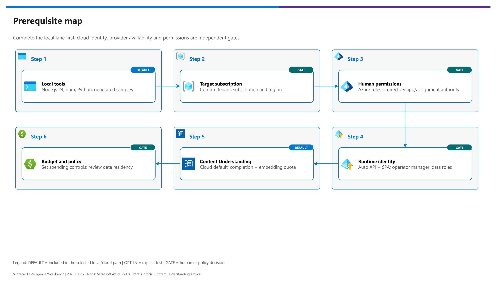
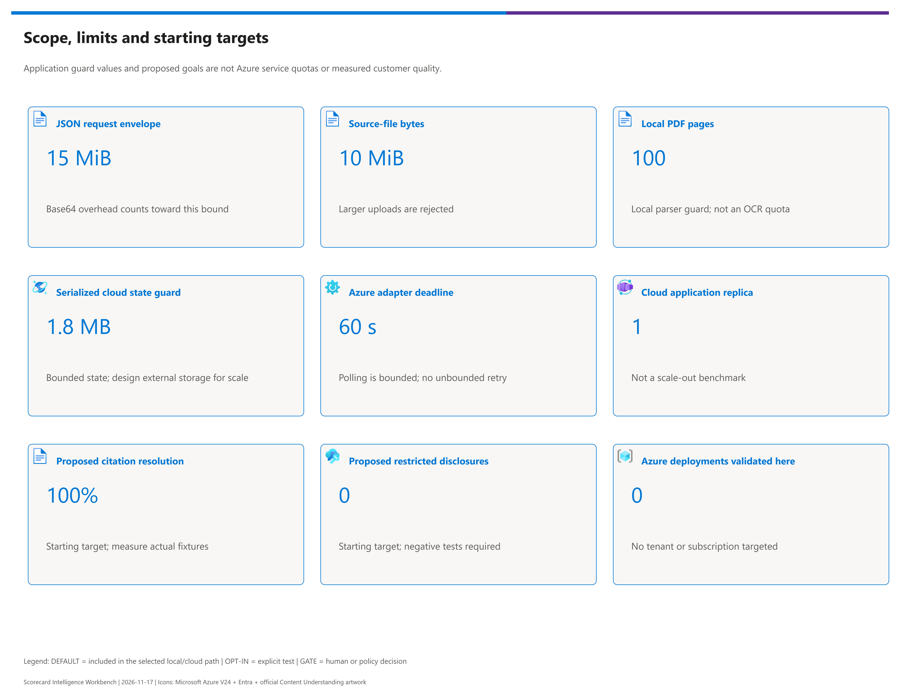

[README](../README.md) › [Reproduce](./00-reproduce-this-demo.md) › Prerequisites

# 02 — Prerequisites

<p>
&nbsp;
&nbsp;
&nbsp;

</p>

 

This checklist is for the person preparing a workstation or an isolated Azure evaluation environment. Local rehearsal needs no Azure account. The hosted path additionally needs an explicitly approved tenant/subscription, role-bearing application identity and resource permissions. Do not equate the ability to create a resource with permission to process organizational documents.

## At a glance

| | Gate | Ready means |
|---|---|---|
|  | Workstation | Node.js 24+, npm lockfile install and PowerShell 7 for scripts. |
|  | Cloud user access | Permission for automatic owned API/SPA app and service-principal creation/reuse, SPA preauthorization and current-operator manager assignment; externally managed existing identity requires `AUTO_CONFIGURE_ENTRA=false` and manual callback/roles. |
|  | Runtime access | User-assigned identity has only the required data roles. |
|  | Approval | Region, quota, budget, retention and deletion owner agreed. |

## Readiness map

[](./assets/prerequisites-map.png)

<sub>Editable source: [prerequisite map](./assets/prerequisites-map.drawio).</sub>

| Path | Required tools | Not required | Recommendation |
|---|---|---|---|
| Local application | Node.js 24+, npm, browser | Azure subscription, Docker, model deployment | Start here. |
| Documentation checks | Python 3; draw.io desktop to re-export | Cloud credentials | Use local offline icons and badges. |
| Azure fast path | PowerShell 7, Azure CLI with Container Apps support, Azure Developer CLI | Local Docker daemon for remote build | Prefer `azd up` after target verification. |
| Manual cloud | Same Azure tools; Portal for visible steps | Bicep execution in manual mode | Use a separate environment from the IaC path. |

## Identity and permissions

| Resource / principal | Required access | Why |
|---|---|---|
|  Deployment operator | Resource creation and provider registration in intended subscription | Creates the resource group and hosted foundation. |
|  Role-assignment operator | Authorization to assign required Azure roles | Contributor alone is not blanket role-assignment permission. |
|  API application | Single-tenant v2 API audience GUID; delegated scope and Users/Groups roles `reviewer`, `manager`, `auditor` | Scope consent and app-role assignments are separate requirements. |
|  Public SPA client | Separate client ID; SPA-platform redirect `<appUrl>/auth/callback`; delegated permission to this API | Browser uses authorization code + S256 PKCE without a client secret. |
|  Runtime identity | `AcrPull` on the registry | Pull image without registry admin credentials. |
|  Runtime identity | Cosmos DB Built-in Data Contributor scoped appropriately | Read/write the workbench state through the NoSQL data plane. |
|  Runtime identity and setup principal, if enabled | Cognitive Services User on the dedicated Content Understanding resource | Runtime analyzes authorized sources; setup configures missing model defaults and creates the custom analyzer without service keys. |
|  Runtime identity, if enabled | Cognitive Services OpenAI User on model resource | Invoke the configured deployment. |

Managed identity does not replace user authentication. The server validates API access tokens; the managed identity separately authenticates downstream service calls. See [claims validation](https://learn.microsoft.com/en-us/entra/identity-platform/claims-validation), [Container Apps identity](https://learn.microsoft.com/en-us/azure/container-apps/managed-identity) and [Cosmos data-plane roles](https://learn.microsoft.com/en-us/azure/cosmos-db/nosql/how-to-connect-role-based-access-control).

> [!IMPORTANT]
> Automatic identity setup defaults on. The signed-in operator must already be allowed to manage applications/service principals and assign users to application roles; Azure Contributor alone does not grant directory authority. Tenant policy may require an application administrator. Bootstrap never elevates directory privileges, grants Microsoft Graph application permissions, or grants tenant-wide admin consent. It preauthorizes the SPA only for this demo API and assigns only the current operator `manager`. See [identity setup](./03-deployment.md#phase-1--prepare-configuration-and-application-identity), then test actual hosted sign-in. No client secret, Blob token store or platform-managed auth configuration is required.

## Region alignment — publication snapshot 2026-11-17

| Tier | Selection strategy | Consequence | Recommendation |
|---|---|---|---|
| Tier 1 | Same approved region for runtime, database and default-on AI where available | Simpler residency and latency review | Preferred when the configured deployments are available and quota is granted. |
| Tier 2 | Runtime/database together; approved separate region for AI | Cross-region data transfer and latency need review | Accept only with explicit data-residency approval. |
| Tier 3 | Explicit reduced-footprint opt-out of cloud AI | Real local parsers and deterministic answers remain available | Not the full default demo; use when model or extraction capacity is unavailable, never simulate cloud success. |

Runtime/foundation location remains explicit. AI regions and model defaults are documented in [configuration](./08-configuration-reference.md); none guarantees availability. Product support, deployment type, model/version and subscription quota are separate checks for the exact configured deployment.

The tier labels above are this pattern's deployment recommendations, not service-assigned regional tiers. The [Content Understanding region publication](https://learn.microsoft.com/en-us/azure/ai-services/content-understanding/language-region-support), checked 2026-11-17, lists `australiaeast`, `canadacentral`, `eastus`, `eastus2`, `japaneast`, `southcentralus`, `southeastasia`, `swedencentral`, `uksouth`, `westeurope`, `westus` and `westus3`. This is not a quota reservation or evidence that your selected completion/embedding versions and deployment SKUs are available there.

| Component | Availability gate | Publication status |
|---|---|---|
|  Container Apps environment | Region/provider support and regional capacity |  Verify at deployment time. |
|  Cosmos DB for NoSQL | Account creation policy, region and throughput quota |  Verify at deployment time. |
|  Content Understanding | Supported region, AIServices S0 account, two compatible completion/embedding deployments, custom analyzer and role |   API `2025-11-01`; no live validation. |
|  Azure OpenAI | Exact model/version/SKU, Responses + structured-output support, quota |  Configurable shipped defaults; verify quota. |

<details><summary><b>Availability checks after explicit authentication</b></summary>

```powershell
# First complete Phase 0 of the deployment runbook.
az provider show --subscription $SubscriptionId --namespace Microsoft.App --query registrationState -o tsv
az provider show --subscription $SubscriptionId --namespace Microsoft.DocumentDB --query registrationState -o tsv
az provider show --subscription $SubscriptionId --namespace Microsoft.CognitiveServices --query registrationState -o tsv
az account list-locations --subscription $SubscriptionId -o table
az cognitiveservices account list-skus --subscription $SubscriptionId --kind AIServices --location $ContentUnderstandingLocation -o table
# After account creation, inspect the account's supported models.
az cognitiveservices account list-models --subscription $SubscriptionId --resource-group $ResourceGroup --name $OpenAIAccount -o json
```

These are operator-run commands; none were run to author these docs. A locations list does not prove service/model availability. Recheck [Content Understanding region support](https://learn.microsoft.com/en-us/azure/ai-services/content-understanding/language-region-support), [supported model deployments](https://learn.microsoft.com/en-us/azure/ai-services/content-understanding/concepts/models-deployments), [Azure OpenAI model documentation](https://learn.microsoft.com/en-us/azure/ai-services/openai/concepts/models), [retirement guidance](https://learn.microsoft.com/en-us/azure/ai-services/openai/concepts/model-retirements) and the account quota page.

</details>

## Resource footprint and budget

| Resource | Shipped choice | Cost driver | Recommendation |
|---|---|---|---|
|  Container Apps | Bounded single replica | Active CPU/memory and environment configuration | Stop/delete disposable environments after use. |
|  Registry | Basic, admin disabled | Registry storage and remote builds | Keep only necessary test image tags. |
|  Cosmos DB | Standard provisioned throughput; default 400 RU/s | Provisioned throughput and stored data | This is a template choice, not a universal minimum for every Cosmos mode. |
|  Log Analytics | PerGB2018, default 30-day retention | Log ingestion and retention | Do not log prompts or raw documents. |
|  Default cloud extraction | Dedicated AIServices S0 account, configured completion and embedding deployments | Extraction/contextualization plus model token usage; deployment type/capacity | Authorize whole documents for model processing; budget independently from answers. |
|  Default cloud answers | OpenAI resource S0 + configured model SKU | Selected deployment, capacity and usage | Budget for the default deployment; opt out explicitly for a reduced footprint. |

No dollar estimate is invented here. Build a dated estimate in the [Azure pricing calculator](https://azure.microsoft.com/en-us/pricing/calculator/) using your region, retention, throughput, pages and token volumes. Budget alerts are notifications, not a hard spend cap.

For custom extraction, plan two distinct supported model deployments on the dedicated extraction account: completion and embedding. Review each shipped default's exact name, version, deployment name, SKU and capacity; override only with a compatible available selection. The data-plane setup script fills missing resource-default mappings and creates the analyzer; it does not overwrite existing mappings or replace a different schema. Changing domain/schema/model choices needs a new analyzer ID or a deliberate external migration. The separate default Responses deployment is not automatically reused for extraction.

## Scope and starting targets

[](./assets/scope-and-targets.png)

<sub>Editable source: [scope and targets](./assets/scope-and-targets.drawio).</sub>

> [!WARNING]
> Tiny synthetic fixtures are not a capacity or quality benchmark. Proposed zero-disclosure and citation-resolution goals are starting targets to test, not results from an organizational corpus.

The local JSON store is for one trusted process. Cosmos stores a bounded workbench state; do not treat it as an unlimited source-file archive. Review request limits, database item-size behavior and extraction timeouts in [configuration](./08-configuration-reference.md) before increasing sample sizes. Scans and chart-only values require additional cloud evaluation; never convert an empty extraction into invented measurements.

## Final pre-flight checklist

| Check | Local | Azure |
|---|---|---|
| Runtime and locked install | ☐ Node 24+, `npm ci` | ☐ Remote build supported. |
| Neutral data only | ☐ Generated synthetic files | ☐ Approved retention and data handling. |
| Authentication | ☐ Loopback synthetic session | ☐ API app roles, tenant and audience verified. |
| Service permissions | Not needed | ☐ Registry pull and Cosmos data roles. |
| AI providers | Local only; no automatic cloud processing | ☐ Both cloud providers on by default; review regions, deployments, quota, runtime/setup roles and whole-document authorization. |
| Costs | No Azure spend | ☐ Budget, cleanup owner and deletion scope. |
| Acceptance | ☐ Local test output saved | ☐ Cloud validation remains pending until run. |

Next: [Deployment](./03-deployment.md).

*Last updated: 2026-11-17*
