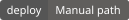
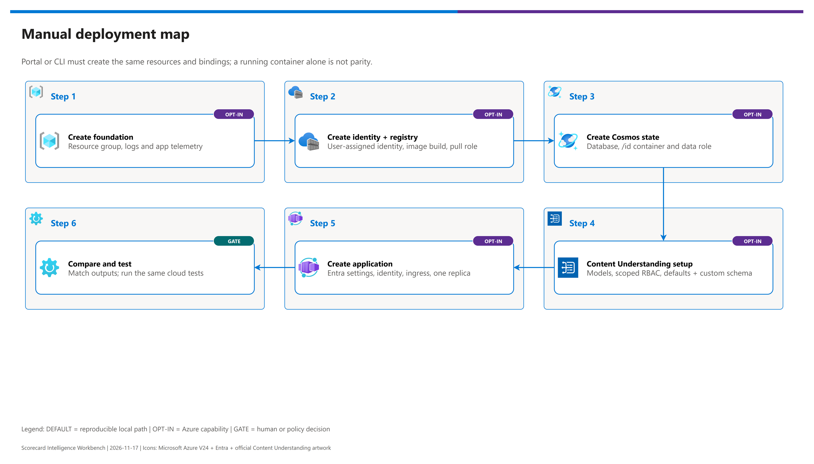

[README](../README.md) › [Reproduce](./00-reproduce-this-demo.md) › Manual deployment

# 03b — Manual Portal and CLI deployment

<p>
&nbsp;
&nbsp;
&nbsp;

</p>

  

This runbook creates the same logical resources and permissions as the Bicep path without submitting an infrastructure template. It is for teams that need to inspect creation steps in the Portal or use imperative resource operations. The supplied manual runner performs explicit resource requests and remote image build; it does not call an ARM deployment or Bicep.

## At a glance

| | Question | Answer |
|---|---|---|
|  | Runnable no-IaC entry point | `scripts/deploy.ps1 -Manual` after explicit authentication. |
|  | Resource parity | Same types, SKUs, security properties and outputs as the template. |
|  | Permission parity | Registry pull, Cosmos data role and optional AI user roles. |
|  | Output parity | Same ignored `demo-ids.local.json` keys; preserve the `domain` block. |

## Manual deployment map

[](./assets/manual-deployment-steps.png)

<sub>Editable source: [manual steps](./assets/manual-deployment-steps.drawio).</sub>

| Criterion | Bicep / azd | Manual | Recommendation |
|---|---|---|---|
| Repeatability | Declarative shared templates | Ordered imperative operations | Prefer azd unless policy or teaching goals require manual. |
| Time | One reviewed workflow | Allow extra time for each resource, role and verification | Plan a separate workshop session; no measured time guarantee. |
| Names | Prefix + environment + Bicep unique hash | Same neutral prefixes + environment + manual stable hash | Use a fresh resource group; never alternate paths in one environment. |
| Local outputs | Hook writes them | Runner writes them; Portal-only operator writes by hand | Validate every required output before starting the application. |

> [!WARNING]
> The naming hash implementation differs between the two provisioning paths. They are resource-equivalent, not interchangeable update mechanisms. Do not point the manual runner at a group created by Bicep or mix ownership of existing resources.

## Phase 0 — Confirm the target

<details><summary><b>Authenticate and run the complete imperative equivalent</b></summary>

```powershell
$TenantId = '<approved-tenant-id>'
$SubscriptionId = '<approved-subscription-id>'
$Location = '<approved-region>'
$Audience = '<existing-api-application-client-id-guid>'
$env:ENTRA_CLIENT_ID = '<existing-public-spa-client-id-guid>'
$env:ENTRA_API_SCOPE = 'api://<existing-api-application-client-id-guid>/access_as_user'
$EnvironmentName = 'workbench02'
$ResourceGroup = "rg-$EnvironmentName"

az login --tenant $TenantId
az account set --subscription $SubscriptionId
az account show --query '{tenant:tenantId,subscription:id,user:user.name}' -o table
# Stop unless both target identifiers match.
$env:DEPLOY_CONTENT_UNDERSTANDING = 'false'
$env:DEPLOY_OPENAI = 'false'
.\scripts\deploy.ps1 -Manual -TenantId $TenantId -SubscriptionId $SubscriptionId `
  -EnvironmentName $EnvironmentName -Location $Location `
  -EntraAudience $Audience -ResourceGroup $ResourceGroup
```

Inspect [`infra/deploy-manual.ps1`](../infra/deploy-manual.ps1) before running if you need change-by-change review. It contains the concrete ordered resource requests. The shared validator stops on an invalid target, audience, name or unsupported configuration.

</details>

The remainder documents the Portal equivalent and the relevant CLI operations for each resource group. Do not execute both the full runner and the same creation commands as separate competing deployments. Reuse the runner's output names when inspecting an environment it created.

## Phase 1 — Resource group, logs and telemetry

| Step | | Portal equivalent | Imperative operation / parity check |
|---|---|---|---|
| **1.1** |  | Resource groups → Create → explicit subscription and region | `az group create --subscription $SubscriptionId --name $ResourceGroup --location $Location` |
| **1.2** |  | Log Analytics workspaces → Create | PerGB2018, reviewed retention, same region as runtime. |
| **1.3** |  | Application Insights → Create → workspace-based resource | Web application type, linked workspace; retain connection string locally. |

<details><summary><b>Foundation CLI equivalent</b></summary>

```powershell
$LogName = "log-$EnvironmentName"
$InsightsName = "appi-$EnvironmentName"
az monitor log-analytics workspace create --subscription $SubscriptionId `
  --resource-group $ResourceGroup --workspace-name $LogName --location $Location `
  --sku PerGB2018 --retention-time 30
$WorkspaceId = az monitor log-analytics workspace show --subscription $SubscriptionId `
  --resource-group $ResourceGroup --workspace-name $LogName --query id -o tsv
az monitor app-insights component create --subscription $SubscriptionId `
  --resource-group $ResourceGroup --app $InsightsName --location $Location `
  --application-type web --workspace $WorkspaceId
```

The standalone examples use neutral readable names. The complete runner additionally derives deterministic suffixes for globally scoped names and writes all final names to outputs.

</details>

Gate: logs resource exists; application telemetry resource is linked. A configured connection string is not proof of request tracing—the server must emit telemetry for that claim.

## Phase 2 — Identity, registry and image

| Step | | Portal equivalent | Required setting |
|---|---|---|---|
| **2.1** |  | Managed Identities → Create | User-assigned identity; retain resource, client and principal IDs. |
| **2.2** |  | Container registries → Create | Basic, admin disabled, RegistryPermissions role mode. |
| **2.3** |  | Registry → Access control → Add role assignment | `AcrPull` for the runtime identity, registry scope. |
| **2.4** |  | Use Cloud Shell or your approved terminal for source build | Remote build from repository Dockerfile; no credentials in context. |

<details><summary><b>Identity and registry CLI equivalent</b></summary>

```powershell
$IdentityName = "id-$EnvironmentName"
$RegistryName = '<globally-unique-neutral-registry-name>'
az identity create --subscription $SubscriptionId --resource-group $ResourceGroup `
  --name $IdentityName --location $Location
$IdentityId = az identity show --subscription $SubscriptionId -g $ResourceGroup -n $IdentityName --query id -o tsv
$PrincipalId = az identity show --subscription $SubscriptionId -g $ResourceGroup -n $IdentityName --query principalId -o tsv
$ClientId = az identity show --subscription $SubscriptionId -g $ResourceGroup -n $IdentityName --query clientId -o tsv
az acr create --subscription $SubscriptionId -g $ResourceGroup -n $RegistryName `
  --location $Location --sku Basic --admin-enabled false
$RegistryId = az acr show --subscription $SubscriptionId -g $ResourceGroup -n $RegistryName --query id -o tsv
az role assignment create --subscription $SubscriptionId --assignee-object-id $PrincipalId `
  --assignee-principal-type ServicePrincipal --role AcrPull --scope $RegistryId
az acr build --subscription $SubscriptionId --registry $RegistryName --image app:manual --file Dockerfile .
```

</details>

Gate: identity can pull the built image. Follow [managed-identity image pull](https://learn.microsoft.com/en-us/azure/container-apps/managed-identity-image-pull); do not enable registry admin passwords to work around an RBAC delay.

## Phase 3 — Cosmos DB persistent state

| Step | | Portal equivalent | Required setting |
|---|---|---|---|
| **3.1** |  | Azure Cosmos DB → Create → NoSQL | Standard provisioned-throughput account; local/key auth disabled. |
| **3.2** |  | Data Explorer → New Database | `workbench` unless explicitly overridden. |
| **3.3** |  | Data Explorer → New Container | `state`, partition key `/id`, configured throughput. |
| **3.4** |  | Use native data-plane role operation through CLI if Portal has no equivalent | Cosmos DB Built-in Data Contributor for runtime identity. |

<details><summary><b>Cosmos CLI equivalent</b></summary>

```powershell
$CosmosName = '<globally-unique-neutral-cosmos-name>'
az cosmosdb create --subscription $SubscriptionId -g $ResourceGroup -n $CosmosName `
  --locations regionName=$Location failoverPriority=0 --default-consistency-level Session
az cosmosdb update --subscription $SubscriptionId -g $ResourceGroup -n $CosmosName --disable-local-auth true
az cosmosdb sql database create --subscription $SubscriptionId -g $ResourceGroup `
  --account-name $CosmosName --name workbench
az cosmosdb sql container create --subscription $SubscriptionId -g $ResourceGroup `
  --account-name $CosmosName --database-name workbench --name state --partition-key-path /id --throughput 400
$DataRole = az cosmosdb sql role definition list --subscription $SubscriptionId `
  -g $ResourceGroup --account-name $CosmosName `
  --query "[?roleName=='Cosmos DB Built-in Data Contributor'].id | [0]" -o tsv
az cosmosdb sql role assignment create --subscription $SubscriptionId -g $ResourceGroup `
  --account-name $CosmosName --principal-id $PrincipalId --role-definition-id $DataRole --scope '/'
```

</details>

The scope shown matches the bounded account-owned workbench. For a shared account, narrow and validate the scope. Cosmos data-plane RBAC is not ordinary account IAM ([Microsoft Learn](https://learn.microsoft.com/en-us/azure/cosmos-db/nosql/how-to-connect-role-based-access-control)); Portal-only parity may require an administrator to execute this native role step.

## Phase 4 — Optional extraction and model resources

| Step | | Portal equivalent | Parity requirement |
|---|---|---|---|
| **4.1** |  | Create dedicated Microsoft Foundry resource for Content Understanding | AIServices kind, S0, approved region, custom subdomain, local auth disabled; explicit compatible completion **and** embedding deployments. |
| **4.2** |  | Create Azure OpenAI resource and a verified compatible deployment | Explicit model name, version, deployment name, SKU and capacity. |
| **4.3** |  | Service IAM → Add role assignment | Cognitive Services User on extraction for runtime and setup principal; Cognitive Services OpenAI User on the separate answer resource. |
| **4.4** |  | Content Understanding Studio / data-plane setup script |  Fill only missing model defaults; create domain-derived custom schema with confidence and source grounding, API `2025-11-01`. Analyzer setup is not an ARM resource. |

> [!IMPORTANT]
> Keep both resources disabled unless needed. The complete manual runner implements the optional resources and roles from the same settings as the template; it refuses to invent a model or deployment SKU.

Use the [optional-provider recipe](./03-deployment.md#phase-4--enable-extraction-and-answers-independently) before running `deploy.ps1 -Manual`. The shared runner calls `scripts/configure-content-understanding.mjs`; Portal-only operators must also complete that data-plane setup. An account and model deployments alone are not parity. Conflicting model defaults or an existing mismatched analyzer cause setup to stop, not overwrite: select a new analyzer ID or plan a separate migration. Review source-data residency and whole-document authorization for model processing before using extraction; detecting restricted text only after analysis does not mean it was excluded from model input.

## Phase 5 — Environment, application and settings

| Step | | Portal equivalent | Parity requirement |
|---|---|---|---|
| **5.1** |  | Container Apps environments → Create | Link the Log Analytics workspace; same intended runtime region. |
| **5.2** |  | Container Apps → Create → existing environment | Private registry image, user-assigned identity, external HTTPS ingress on application port. |
| **5.3** |  | Application → Containers → environment variables | Apply the cloud runtime settings from the configuration reference. |
| **5.4** |  | Scale / identity / registry settings | One replica; Entra mode; managed identity for image and data access. |

The complete manual runner handles environment and application ARM bodies, registry identity and settings together. For visible step-by-step changes, inspect `Invoke-ManualDeployment` and execute its resource sections under a change review. This avoids incomplete CLI flags creating a public container without the required authentication/state settings.

Required app settings include `AUTH_MODE=entra`, explicit tenant/API-audience GUID, `ENTRA_CLIENT_ID` for the public SPA, full `ENTRA_API_SCOPE`, `COSMOS_ENDPOINT`, database/container, `AZURE_CLIENT_ID`, provider switches and optional endpoints. Complete the same [API/SPA registration, consent, app-role and exact callback setup](./03-deployment.md#portal-identity-setup--required-outside-bicep) as the IaC path. The browser uses PKCE; no client secret, Blob token store or platform auth resource is needed. See the [complete configuration reference](./08-configuration-reference.md#runtime-environment). Never set cloud auth to `local`.

## Phase 6 — Outputs and validation

| Output | Portal location | Local key |
|---|---|---|
|  Application URL | Container App → Overview → Application URL | `appUrl` |
|  Database endpoint | Cosmos DB → Overview | `cosmosEndpoint`, database/container names |
|  Identity | Managed identity → Overview | `managedIdentityClientId`, `azureOutputs` |
|  Optional endpoints/deployment | Respective resource Overview / deployment page | `modelEndpoint`, `modelDeployment`, extraction endpoint |

The full runner writes these automatically and preserves `domain`. Portal-only operators must populate the same ignored file by hand; do not commit it. Complete [Phase 3 identity/persistence checks](./03-deployment.md#phase-3--validate-deployed-identity-and-state) and the [cloud test matrix](./04-testing.md#live-validation). Those tests are identical for both deployment paths.

Next: [Testing](./04-testing.md).

*Last updated: 2026-11-17*
