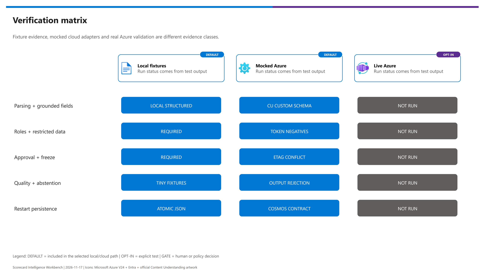
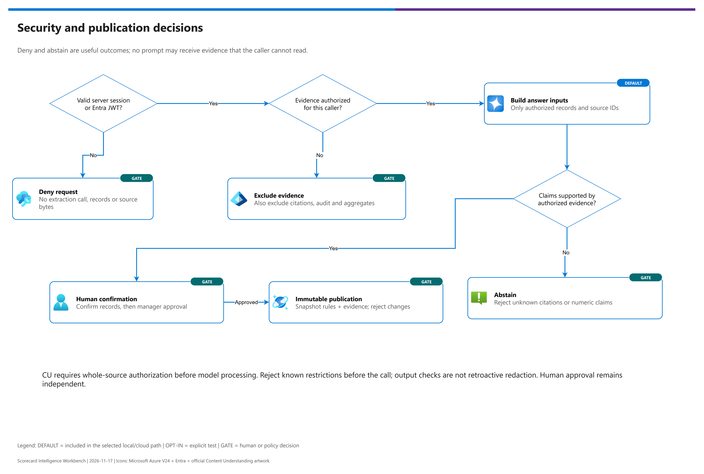
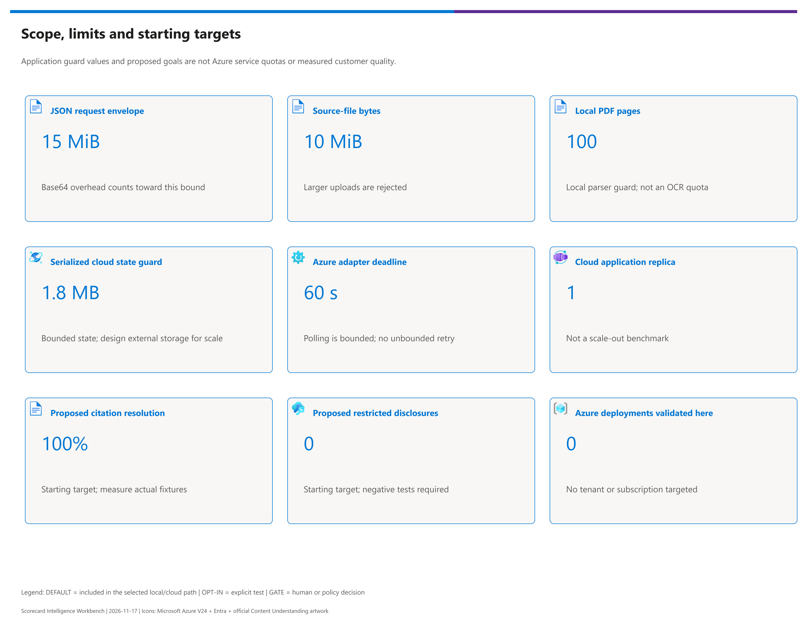
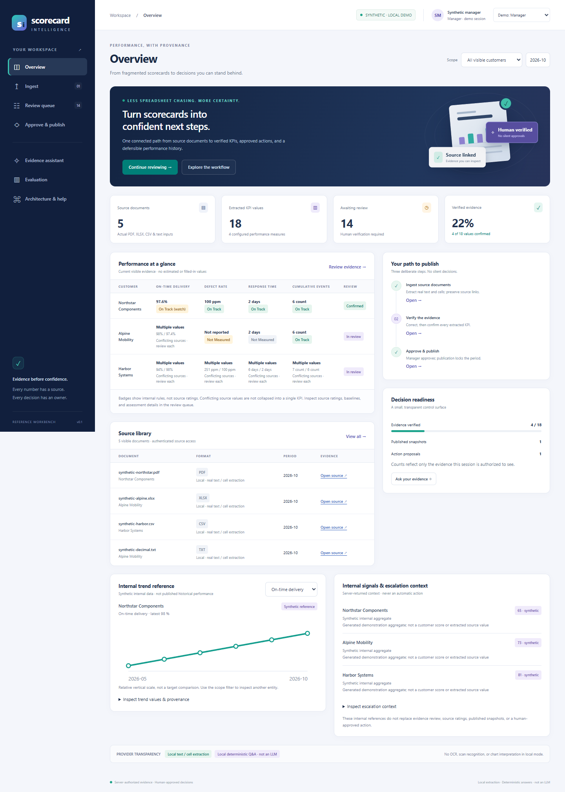
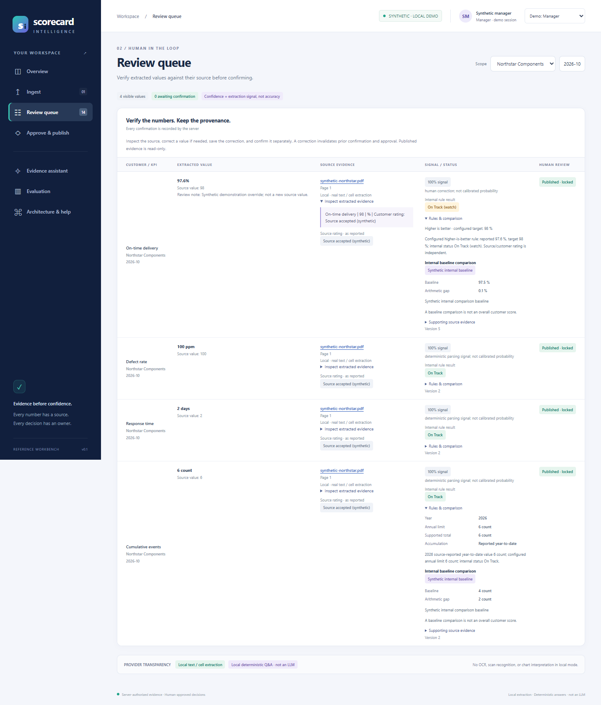

[README](../README.md) › [Reproduce](./00-reproduce-this-demo.md) › Testing

# 04 — Testing and evidence

<p>
&nbsp;
&nbsp;
&nbsp;

</p>

 

This runbook verifies the workbench's evidence chain, authorization boundaries and review lifecycle. It is for implementers and evaluators who need reproducible commands and explicit failure criteria. Small synthetic fixtures, mocked Azure adapters and live Azure service tests are separate classes of evidence; never combine their results into one unexplained accuracy number.

## At a glance

| | Test question | Expected proof |
|---|---|---|
|  | Was extraction real? | Generated/uploaded file bytes yield page/cell/row evidence. |
|  | Was forbidden content excluded? | It is absent from state, prompt inputs, answers, citations, audit and aggregates. |
|  | Was publication authorized? | Confirmed records, manager approval and immutable snapshot. |
|  | What quality was actually measured? | Fixture counts and denominators from the evaluation command. |

## Verification matrix

[](./assets/testing-matrix.png)

<sub>Editable source: [testing matrix](./assets/testing-matrix.drawio).</sub>

| Layer | Command | Scope | Interpretation |
|---|---|---|---|
| Local core | `npm test` | Parsing, roles, normalization, workflows, adapter contracts | Tests run against generated input or controlled state, not Azure. |
| Fixture evaluation | `npm run evaluate` | Known synthetic expected values and boundaries | Actual tiny-fixture measurements; not a customer benchmark. |
| Browser | `npm run test:browser` | Real server/browser lifecycle and visible evidence | Local synthetic browser proof only. |
| Documentation | `python -m unittest discover -s tests -p test_doc_visuals.py` | Strict visuals, links/anchors, exports | Static documentation integrity. |
| Cloud | Operator-run matrix below | Real token/service/region behavior |  Pending until executed. |

> [!IMPORTANT]
> A passing fixture is evidence for that fixture only. Proposed targets below are starting acceptance targets, not attained organizational-quality results.

## Run the reproducible local suite

<details><summary><b>Commands from the repository root</b></summary>

```powershell
npm ci
npm run samples
npm test
npm run evaluate
npm run test:browser
python scripts/lint_doc_visuals.py --strict
python scripts/export_diagrams.py docs/assets --check
python -m unittest discover -s tests -p test_doc_visuals.py
```

Install dependencies once with the lockfile. Do not repair a failing test by changing expected values without inspecting the source evidence. If a browser channel is absent, use an installed supported channel via `PLAYWRIGHT_CHANNEL`; the browser harness uses an isolated state file.

</details>

| Step | | Inspect | Failure action |
|---|---|---|---|
| **1** |  | Sample PDF, workbook and CSV actually exist | Regenerate samples; never substitute result-only JSON. |
| **2** |  | Evaluation `summary`, `results`, `limitations` | Preserve denominator and failing case details. |
| **3** |  | Reviewer and manager paths, audit view | Compare server response and visible affordance; UI hiding alone is insufficient. |
| **4** |  | Isolated state survives server restart | Investigate store writes/concurrency before repeating. |

## Functional and adversarial cases

| Area | Positive case | Negative / edge case | Required result |
|---|---|---|---|
| PDF | Extract embedded text with page | Image-only scan under local provider | No invented values; explicit unsupported/empty evidence warning. |
| XLSX | Read numeric/text cells with sheet + cell | Formulas, missing values or malformed workbook | Preserve available evidence; reject or flag what cannot be supported. |
| CSV | Header/alias normalization with row evidence | Decimal comma, quoted fields, unknown KPI, missing number | Correct normalization or unresolved review state. |
| Input validation | Supported extension and encoded bytes | Spoofed media, malformed base64, unknown fields, oversized body | Safe 4xx response without a stack or source leakage. |
| Confirmation | Supported numeric record | Unknown KPI or missing value | Cannot confirm unresolved evidence. |
| Thresholds | Boundary values for higher/lower direction | Unit mismatch, nonfinite number, tied boundary | Deterministic documented status, not model judgment. |
| Annual cumulative | Explicit source YTD or complete unique monthly sum | Missing/duplicated/uncertain months, absent annual limit | Abstain on incomplete totals; block period approval. |
| Source rating and baseline | Preserve source rating and explicit internal baseline provenance | No baseline supplied or source label differs from status | No fabricated baseline/gap or overwritten source rating. |
| Publication | Confirm every applicable record, approve as manager, publish | No records, unconfirmed record, stale approval, post-publish edit | Reject; preserve immutable history. |
| Actions | Draft suggestion then manager approval | Auditor/reviewer approving; restricted note input | Reject unauthorized mutation; never guess a personal assignee. |
| Questions | Supported evidence ID and value | Unknown IDs, invented numbers, prompt injection in uploaded text | Abstain/reject unsupported output; treat source text as data. |
| Source access | Authorized document ID | Guessed/unknown/inaccessible document ID | No bytes, even if a citation-like URL is fabricated. |

The POC rejects a mixed upload that contains restricted marked content rather than storing a “safe” excerpt beside recoverable raw restricted bytes. It also rejects newly submitted restricted actions. Defensive filtering still removes legacy restricted objects before state and question construction, including auditor views.

## Authorization and prompt-boundary tests

[](./assets/security-decision-flow.png)

<sub>Editable source: [security decision flow](./assets/security-decision-flow.drawio).</sub>

| Caller / attempt | Read state | Confirm record | Approve / publish | Mutate action |
|---|---|---|---|---|
| Reviewer | Authorized subset | Allowed for supported evidence | Forbidden | Draft only. |
| Manager | Authorized subset | Allowed | Allowed after gates | Approve allowed. |
| Auditor | Authorized subset + server-derived audit view | Forbidden | Forbidden | Forbidden. |
| Browser claims `role=manager` without server authority | No authority gained | Forbidden | Forbidden | Forbidden. |
| Invalid/expired/wrong-audience token | Unauthorized | Unauthorized | Unauthorized | Unauthorized. |

Use a mock answer provider that records its input. Seed a uniquely identifiable restricted marker in controlled legacy state, ask a relevant question, and assert that marker is absent in the provider input, returned state, citations, audit, aggregates and source bytes. Filtering the final answer alone is a failure even if the visible text looks safe.

For Entra, signature/JWKS, expected issuer, audience, tenant, lifetime and application role checks are independent. See [Microsoft token validation guidance](https://learn.microsoft.com/en-us/entra/identity-platform/access-tokens). A decoded token payload is not proof of authenticity.

The PKCE path additionally needs browser tests for S256 challenge construction, one-use transaction/state checking, exact callback, code-exchange failure and memory-only bearer attachment to API/source requests. Signed-token tests must reject an ID token, wrong v2 API audience, wrong tenant, missing delegated scope, wrong scope and missing role. A mocked identity response is useful protocol coverage, not live Entra sign-in validation.

## Quality targets and actual measurements

[](./assets/scope-and-targets.png)

<sub>Editable source: [scope and targets](./assets/scope-and-targets.drawio).</sub>

| Measure | Proposed starting target | Actual result source | Limit |
|---|---|---|---|
| Citation resolution | Every returned citation resolves to allowed source evidence | Evaluation/browser results | Resolvability is not semantic correctness. |
| Restricted disclosures | Zero in observed outputs and answer-provider inputs; known detectable restrictions blocked before extraction | Authorization negative tests | Whole sources go to Content Understanding; output-only discovery cannot prove exclusion from extraction-model input. |
| Threshold correctness | Every tested boundary follows configured direction/rules | Deterministic fixture suite | Does not validate business appropriateness of thresholds. |
| Supported answer coverage | Establish a baseline; do not invent a target | `npm run evaluate` | Deterministic local answers are not LLM quality. |
| Extraction accuracy | Establish per-format annotated baseline | Actual extracted value versus fixture expectation | Tiny generated layout set only. |
| Scan/chart quality | Not measured locally | Approved live Azure holdout evaluation | No target attainment claimed. |

The evaluation endpoint (`GET /api/evaluation`) returns `summary`, per-case `results` and explicit `limitations`. Retain the output from your actual checkout, including failing cases; the UI is a viewer of this measurement, not an independent evaluator.

An overall weighted rating remains undecided. The UI shows counts; do not report those counts as an agreed overall source/customer grade. Source rating, internal threshold status and optional arithmetic baseline gap are distinct fields and require distinct test assertions.

### Current local validation — 2026-11-17

| Check | Observed result | Evidence boundary |
|---|---|---|
| Node automated tests | **66 / 66 passed** in the final integration run: previous 47 plus 19 default/bootstrap/identity cases | Cloud/directory requests are mocked; includes actual restricted-text PDF preflight before an extraction request. No live Azure, Graph or OAuth evidence. |
| Microsoft Edge automated browser suite | **10 / 10 passed** earlier November 17, including missing-unit correction; not rerun for this revision | Real local server/browser rehearsal against unchanged application code; identity-provider protocol is mocked, not a live tenant. |
| Python documentation tests | **3 / 3 passed** earlier November 17; not rerun for this revision | Earlier strict documentation checks, diagram freshness and shipped/embedded icon consistency; see the separate current documentation-check result below. |
| Tiny synthetic evaluation | **23 / 23 passed**, `fixtureOnly=true`, earlier November 17; not rerun for this revision | Actual tiny-fixture snapshot below against unchanged application code; not representative-corpus quality. |
| Documentation checks | **Zero errors/warnings** | Documentation structure, local links/anchors and visual requirements; not application/cloud validation. |
| UI screenshots | Both existing images recaptured November 17 with `CAPTURE_EVIDENCE=1` and visually reviewed | Local synthetic visible state only; no live Content Understanding or Responses call. |

### Actual local fixture snapshot — 2026-11-17

| Generated source format | Observed extraction checks passed | What was checked |
|---|---|---|
| Text-native PDF | 5 / 5 | Four expected KPI/value/source-rating records plus row count. |
| XLSX | 5 / 5 | Four expected records, including a deliberately missing value, plus row count. |
| CSV | 5 / 5 | Four expected records plus row count. |
| TXT | 3 / 3 | Decimal-comma/alias case and unknown KPI plus row count. |
| JSON | 5 / 5 | Four expected records plus row count. |
| Total | **23 / 23**, `fixtureOnly=true` | Four-rule generated baseline; 18 candidate rows and five row-count checks. |

These are actual `npm run evaluate` results, not proposed targets. They include preservation of supplied synthetic source ratings, not validation of the source author's business judgment. The evaluator's `accuracy: 1` is the fraction of these tiny deterministic checks that passed—not an extraction-accuracy estimate for unseen documents. It does not measure organizational rating-policy correctness, model reasoning, scan OCR, chart values, latency, business outcomes or security completeness. Regenerate and rerun after changing `domain`; the denominator changes with the configured fixture.

Confidence labels in local extraction are deterministic signals: known parse = 1, missing = 0, explicitly uncertain = 0.5. They are **not calibrated probabilities**. Do not average them into an accuracy claim. Rules version and threshold values belong in the published snapshot so an evaluator can reproduce the status later.

## Mocked Azure adapter regression

| Adapter | Required mocked cases | Why |
|---|---|---|
| Content Understanding custom schema |  Request/typed fields, nested confidence and grounding, UTF-16 spans, missing/invalid numeric spans, unsafe operation URL, failed/canceled poll, timeout and malformed result | Never fabricate source grounding or scrape arbitrary Markdown numbers as fallback; no failed analysis reported as success. |
| Content Understanding setup | Existing compatible analyzer, new analyzer, missing defaults, conflicting defaults/schema and identity/role failure | Add missing model defaults only; never overwrite existing mappings or replace a mismatched analyzer automatically. |
| Responses | Provider error, invalid schema, unknown evidence ID, unsupported numeric claim, empty answer | Structured output is a shape constraint, not truth validation. |
| Cosmos | Stale ETag, serialized-state bound, restart/reload, conflict response | Avoid silent lost updates and item-size surprises. |
| Credentials | Wrong local tenant/subscription before live token acquisition | A correct endpoint does not fix a credential minted for the wrong target. |

### Default-cloud bootstrap verification boundary

| Boundary | Focused static/mock expectation | Still requires live validation |
|---|---|---|
| Defaults and orchestration | Both AI switches default `true`; preup/bootstrap persists explicit target and identity before parameter resolution; preprovision remains validation-only | First-time `azd up`, actual directory policy and deployment ordering. |
| Directory identity | API/SPA apps, service principals, API scope/app roles and scoped SPA preauthorization; only current operator receives demo `manager` | Actual tenant Graph permissions, token claims, sign-in and role-negative checks using separately assigned test users. |
| Reuse and safety | Same-target previously auto-created managed apps reused; unowned lookalikes rejected; externally managed apps require automation opt-out and manual callback/roles | Ownership/consent policy in the selected tenant; opt-out does not mutate directory identity; no privilege escalation or tenant-wide consent. |
| Callback and analyzer | Exact callback is merged without deleting existing URIs; missing CU mappings/analyzer initialized, conflicts rejected | Actual callback round trip, role propagation, model availability/quota and genuinely grounded extraction. |
| Cleanup | Azure deletion does not imply directory cleanup; explicit app/SP cleanup documented | Operator verifies and removes only disposable demo-owned identity after reviewing dependants. |

The 19 new default/bootstrap/identity cases are included in the 66-test Node result above, not an additional test total. The table separates static/mock expectations from still-required live evidence. Default-on provisioning does not enable cloud calls in local rehearsal. No live Entra, Graph, OAuth, Azure deployment, quota reservation or model-provider validation was performed for this revision.

API contracts were checked against [Content Understanding Analyze](https://learn.microsoft.com/en-us/rest/api/contentunderstanding/content-analyzers/analyze?view=rest-contentunderstanding-2025-11-01), [custom analyzers](https://learn.microsoft.com/en-us/azure/ai-services/content-understanding/concepts/analyzer-reference), [Responses](https://learn.microsoft.com/en-us/azure/ai-services/openai/how-to/responses) and [structured outputs](https://learn.microsoft.com/en-us/azure/ai-services/openai/how-to/structured-outputs). These references do not substitute for live tests.

| Source variant / boundary | Required regression evidence | Evidence limit |
|---|---|---|
|  Native XLSX/CSV/JSON with cloud provider configured | Direct local parsing; mock asserts no Content Understanding request | Does not establish every organizational spreadsheet's semantics. |
|  PDF, unstructured TXT, images and supported Office formats | Typed custom fields with genuine source spans; optional page/region grounded where returned | Evaluate each supported variant separately; no representative-corpus or scan/chart quality claim. |
|  Known restricted upload/text | Rejected before mocked extraction call where detectable | Cannot prove detection/redaction of arbitrary restricted scanned or mixed content. |
|  Restriction found only in cloud output | Reject result before state/answer use | The whole source was already submitted to extraction models. |
|  Numeric calculation and approval | Same deterministic rules, reviewer confirmation and manager publication gates | Confidence/schema validity never substitutes for numeric validation or human review. |

## Actual local browser evidence — 2026-11-17

| Run | Observed result | Boundary |
|---|---|---|
| Microsoft Edge automated browser suite | **10 / 10 passed** with the final four-metric synthetic configuration, including missing-unit correction | Local application and mocked identity-provider protocol; not a live Entra tenant or Azure deployment. |
| Local generated sources | Five actual generated source files; four configured metrics in the full structured fixtures | Tiny synthetic layouts, not representative organizational documents. |
| Captured UI evidence | Overview and detailed review below, recaptured November 17 | Actual provider/format labels, editable units and source-evidence details; not an independent security or accuracy evaluation. |

[](./assets/evidence/workbench-overview.png)

[](./assets/evidence/workbench-review.png)

> [!NOTE]
> These are actual local Edge captures. The scripted story deliberately applies a synthetic numeric override to exercise correction, approval invalidation and publication; it is **not a newly extracted source fact**. The original source value stays visible. Units are editable for source-supported correction, and evidence details show field confidence, spans and geometry only when available; local captures are not proof of live cloud grounding. Baselines, trend/momentum and escalation context are synthetic, source ratings remain independent, and conflicting candidates are not collapsed by choosing the first value.

## Live validation

> [!WARNING]
> No live Azure deployment, OCR run or model-quality result is asserted. Keep this table pending until an operator has run the checks in the explicitly approved environment.

| Check | Current evidence class | Pass criterion |
|---|---|---|
| Azure provision and app revision | Not run | Actual workbench `/health`, not the bootstrap image. |
| Entra positive and negative role tokens | Not run | Correct role allowed; invalid token/role rejected. |
| Cosmos managed-identity persistence | Not run | Synthetic change survives revision restart. |
| Registry managed-identity pull | Not run | Private image runs without admin credentials. |
| Content Understanding approved document variants | Not run | Typed fields, validated source grounding/confidence, explicit uncertainty and human review for each format. |
| Responses structured answer | Not run | Only supported allowed claims; unsupported output abstains. |
| Retention, cost and cleanup | Not run | Reviewed configuration and verified deletion scope. |

For the local scripted story and screenshot evidence, see [Presenter walkthrough](./07-presenter-walkthrough.md). Azure evidence must be separately labeled and sanitized before inclusion.

Next: [Troubleshooting](./05-troubleshooting.md).

*Last updated: 2026-11-17*
