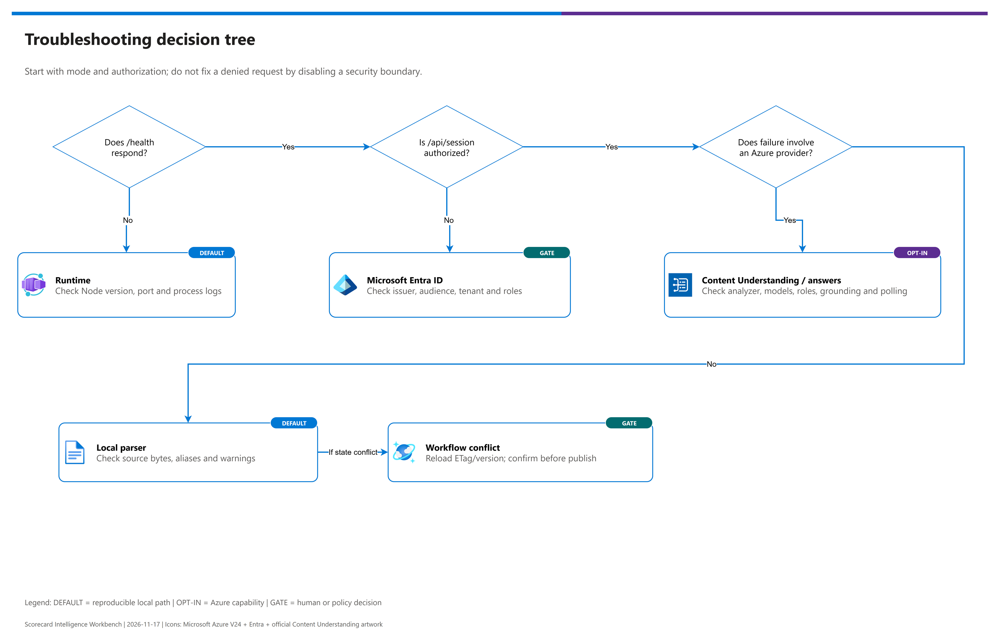

[README](../README.md) › [Reproduce](./00-reproduce-this-demo.md) › Troubleshooting

# 05 — Troubleshooting

<p>
&nbsp;
&nbsp;
&nbsp;

</p>

 

This symptom-led guide helps an operator isolate workstation, parsing, authorization, workflow and Azure-provider failures. Start with the visible provider and auth mode. A safe refusal may be the correct behavior; do not disable authorization, validation or publication guards merely to make a demonstration continue.

## Quick triage

| Symptom | Where | Likely cause | First action |
|---|---|---|---|
| Cannot open application |  Runtime | Process, port, unsupported Node version | Check `node --version`, startup output and `/health`. |
| Role selector missing in Azure |  Identity | Expected behavior | Use Sign in with Microsoft (PKCE); never enable local auth in Azure. |
| Cloud API returns 401 |  Token validation | Missing/wrong/expired access token | Verify issuer, audience, tenant and validity without sharing token. |
| API returns 403 |  Authorization | Role lacks operation | Use the appropriate authorized reviewer or manager. |
| Upload yields no numeric records |  Extraction | Scan, unknown aliases, malformed source | Open source, inspect warnings and mode. |
| Approval fails |  Workflow | Missing confirmation or no applicable records | Resolve every blocking record for that entity/period. |
| Edit returns 409 |  State | Stale version or frozen period | Reload; published records cannot be changed. |
| Azure analysis fails |  Optional extraction | RBAC, endpoint, custom analyzer/default mapping, timeout or unsupported file | Inspect safe error and adapter contract; do not switch to fabricated local success. |
| Model answer abstains |  Optional answers | Unsupported claim/evidence or provider failure | Inspect allowed evidence; do not force a plausible answer. |

## At a glance

| | Diagnostic rule | Why |
|---|---|---|
|  | Record provider/auth labels first | Local deterministic output is not an Azure fallback. |
|  | Inspect original bytes | A visible number can be a chart image rather than extractable text. |
|  | Preserve negative-test failures | A leaked marker is a security defect, not cosmetic output. |

## Decision tree

[](./assets/troubleshooting-decision-tree.png)

<sub>Editable source: [troubleshooting decision tree](./assets/troubleshooting-decision-tree.drawio).</sub>

> [!IMPORTANT]
> Save the safe error code, request path, timestamp, active mode and sanitized reproduction steps. Never include a bearer token, raw restricted document, private identifier or full prompt in a support artifact.

## Runtime and local state

| Check | Command / observation | Remedy |
|---|---|---|
| Supported runtime | `node --version` | Install Node.js 24+; rerun the locked install. |
| Dependencies | Missing-module error | Run `npm ci`; do not swap package versions ad hoc. |
| Port collision | Startup `EADDRINUSE` | Choose an unused `PORT`; stop only a process you own. |
| Bind address | `HOST` is not loopback in local auth | Set `HOST=127.0.0.1`; never expose synthetic roles publicly. |
| State location | Inspect `STATE_FILE` | Use a writable ignored location; separate test and rehearsal state. |
| Restart loses state | Process used a different file/config | Start from the same root and explicit state location. |

<details><summary><b>Minimal workstation diagnosis</b></summary>

```powershell
node --version
npm --version
$env:AUTH_MODE = 'local'
$env:HOST = '127.0.0.1'
$env:PORT = '3000'
$env:EXTRACTION_PROVIDER = 'local'
$env:ANSWER_PROVIDER = 'local'
$env:STATE_PROVIDER = 'local'
npm start
# In a second terminal:
Invoke-RestMethod 'http://127.0.0.1:3000/health'
```

</details>

Do not delete a state file to “repair” a conflict without first preserving the intended test evidence. Local reset is a manager-only synthetic operation. It is deliberately not a cloud administration shortcut.

## Authentication and authorization

| Failure | Investigate | Do not do |
|---|---|---|
| No local session | `POST /api/session` under loopback local mode | Send forged manager headers. |
| Wrong role | `/api/session` user role derived on server | Change browser state to claim authority. |
| Entra 401 | Access token for this API, expected issuer/JWKS, audience, tenant and time | Use an ID token or Graph token as a substitute. |
| Entra 403 | Application role assignment and requested operation | Add blanket permissions to avoid diagnosis. |
| Auditor sees no restricted text | Expected: restricted content is excluded for all roles | Treat audit mode as a bypass. |

JWT decoding is diagnostic only; valid signature, expected v2 claims, delegated scope and API app role are required ([token guidance](https://learn.microsoft.com/en-us/entra/identity-platform/access-tokens)). Hosted sign-in uses a public SPA authorization-code/PKCE flow. Verify `ENTRA_CLIENT_ID`, `ENTRA_API_SCOPE`, API `requestedAccessTokenVersion=2`, delegated consent and API enterprise-app role assignments. A token-exchange CORS error commonly means the exact `/auth/callback` redirect is not registered as platform **SPA**. A reload loses the memory-only access token; sign in again rather than placing tokens in local storage.

## Extraction, units and uncertainty

| Symptom | Explanation | Correct response |
|---|---|---|
| Image-only PDF has no values locally | Embedded-text extraction cannot read scan pixels | Enable approved Azure extraction or use a text-bearing synthetic sample. |
| XLSX formula has no usable value | Cached value or supported scalar may be absent | Enter a source-supported value and document review; do not evaluate arbitrary workbook code. |
| CSV decimal comma parsed unexpectedly | Delimiter and locale are ambiguous | Inspect quoted source row and normalization test; preserve raw text. |
| Unknown KPI cannot confirm | No configured mapping | Add a reviewed alias/KPI in `domain`, then re-ingest and test. |
| Missing numeric value cannot confirm | Evidence unresolved | Correct from source evidence or obtain a valid source. |
| Unit mismatch | A parsed number is not comparable to the configured KPI unit | Correct the unit only with source support; never silently convert unknown scales. |
| Low confidence | Deterministic uncertainty signal or extraction warning | Human review; do not label it a calibrated probability. |

The [custom analyzer reference](https://learn.microsoft.com/en-us/azure/ai-services/content-understanding/concepts/analyzer-reference) describes schema-based field extraction. Inspect the returned typed fields, confidence, source spans and optional document regions. Missing numeric source grounding must abstain; never invent a page/cell citation. A schema-valid response, high confidence or a detected figure is not proof of correct numeric chart interpretation. Validate every source variant and keep human confirmation.

| Symptom | Inspect | Safe action |
|---|---|---|
| Setup 403 | Cognitive Services User for both setup principal and runtime identity; intended resource; propagation | Correct the scoped assignment and retry setup after propagation; never enable keys to bypass it. |
| Defaults conflict | Model-name → deployment-name map on the dedicated extraction account | Setup adds missing entries only. Resolve deliberately outside the automatic path; do not overwrite shared defaults. |
| Existing analyzer mismatch | Analyzer ID, domain-derived field schema and model choices | Use a new analyzer ID or separately reviewed migration; no destructive automatic replacement. |
| No usable numeric evidence | `Metrics` typed values and spans into returned Markdown; source page/region when present | Abstain and inspect the original source; do not scrape arbitrary Markdown numbers as a fallback. |
| Structured file unexpectedly reaches cloud | File extension and actual routing | Native XLSX/CSV/JSON must use local direct parsers even with cloud extraction enabled. |
| Restricted text discovered after extraction | Whole-document authorization and pre-call detectable checks | Reject downstream result, but treat the submitted source as already processed by extraction models. No retroactive redaction claim. |

## Approval, draft actions and history

| Symptom | Expected rule | Recovery |
|---|---|---|
| Reviewer cannot approve action | Only manager approves draft follow-ups | Switch to a genuinely authorized manager. |
| Period approval rejected | Every applicable extracted record must be confirmed; no empty approval | Resolve missing/unknown records rather than dropping them. |
| Edit invalidated approval | Prior approval attested to old content | Review corrected value, reconfirm, then approve again. |
| Publish rejected | Manager approval is absent/stale | Re-read current period state and complete gates. |
| Published edit rejected | Frozen history is intentional | Create a new period/revision workflow; never patch frozen records. |
| Concurrent change rejected | Expected version / ETag differs | Reload and apply an intentional new change. |

> [!NOTE]
> An abstention or blocked publication is a useful outcome when evidence is missing. The demonstration should show the guard working, not conceal it.

## azd, registry, Cosmos and optional AI

| Failure | Safe diagnostic | Remedy |
|---|---|---|
| Preprovision target mismatch | Compare explicit tenant/subscription to `az account show` | Re-authenticate both CLIs to the approved target; do not weaken the hook. |
| Environment name rejected | Check 3–16 lowercase alphanumeric starting with a letter | Choose a fresh valid name. |
| Bootstrap image still running | `/health` is not expected JSON | Complete app build/deploy; provision success is insufficient. |
| Image pull failure | Registry identity and `AcrPull` assignment | Allow RBAC propagation, verify identity binding; no admin password workaround. |
| Cosmos 403 | Native data role, account scope, managed identity client ID | Assign data-plane access, not just management Contributor. |
| State too large | Source bytes and serialized state exceed POC bound | Reduce synthetic inputs; design external storage for larger scale. |
| Layout 401/403 | Endpoint/subdomain, identity role and token audience | Verify service settings; no key copied into the app. |
| Layout timeout | Poll status or unsupported/complex document | Report explicit failure; inspect cloud logs and allowed file size. |
| Responses 400 | Deployment capability or structured-output schema | Select a verified compatible model; do not guess a model/version. |
| Responses 429 | Quota/rate/capacity constraint | Respect provider guidance; bound retries in a reviewed design. |

No automatic telemetry instrumentation claim is made from the existence of an Application Insights resource. Console/runtime logs and explicitly emitted application events are separate evidence. See [Container Apps identity](https://learn.microsoft.com/en-us/azure/container-apps/managed-identity), [Cosmos RBAC](https://learn.microsoft.com/en-us/azure/cosmos-db/nosql/how-to-connect-role-based-access-control) and [Responses](https://learn.microsoft.com/en-us/azure/ai-services/openai/how-to/responses).

## Escalation bundle

| Include | Exclude |
|---|---|
| Commit/version, runtime version, mode and sanitized settings names | Populated IDs, secrets, `.env`, local configuration files. |
| Minimal generated synthetic source that reproduces the failure | Organizational source documents or restricted text. |
| Expected/actual result and safe HTTP status/error code | Stack traces that contain tokens or source content. |
| Relevant test name and exact command | A claim of quality attainment inferred from a screenshot. |

Next: [Why this design](./06-why-this-design.md).

*Last updated: 2026-11-17*
