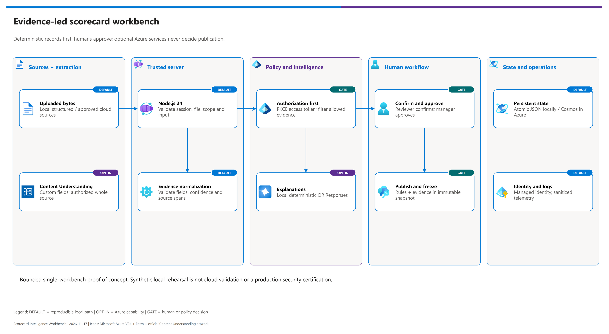
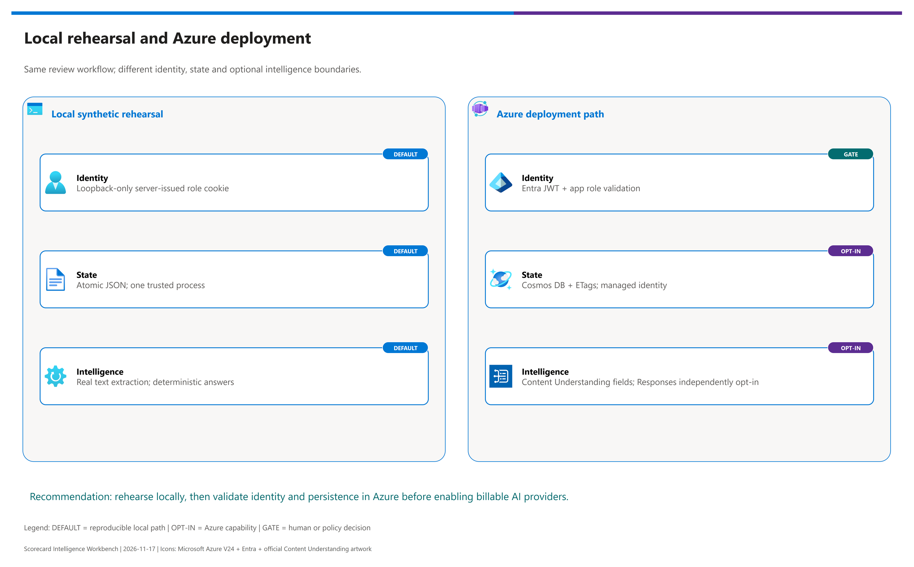
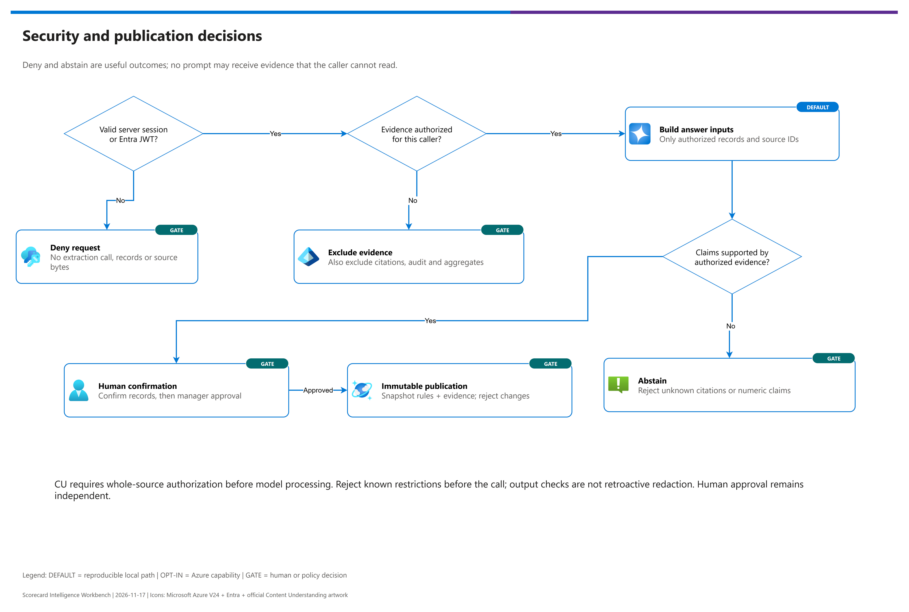

[README](../README.md) › [Reproduce](./00-reproduce-this-demo.md) › Why this design

# 06 — Why this design

&nbsp;
&nbsp;
&nbsp;

  

This forwardable design brief explains why the workbench combines real extraction, deterministic rules, optional language-model explanations and explicit human publication. It is for decision makers and implementers evaluating a small proof of concept—not an assertion that the pattern already meets production, regulatory or organizational-quality requirements.

## At a glance

| | Design principle | Practical effect |
|---|---|---|
|  | Evidence before eloquence | An answer that cannot point to allowed source evidence is not published as fact. |
|  | Rules before model judgment | Status is a reproducible function of numeric value, direction and thresholds. |
|  | Human authority remains explicit | Draft follow-ups and periods require a manager's decision. |
|  | Authorization precedes prompting | Hidden information cannot be “filtered out later” after it has already been sent. |

## The decision story

Editable source: [architecture](./assets/scorecard-intelligence-workbench-architecture.drawio).

The problem is not simply extracting a number. A reviewer must know which source it came from, what it means, whether the unit and period are correct, which rules were used, who confirmed it and whether a later correction changed the decision. A chat-only interface hides too much of that chain. A spreadsheet-only workflow can keep evidence but often leaves review and publication state implicit.

| Approach | Strength | Limitation | Recommendation |
|---|---|---|---|
| Spreadsheet-only review | Familiar cells and formulas | Approval/history/access rules depend on external discipline | Useful baseline; preserve source-cell traceability. |
| Chat-only assistant | Easy natural-language access | Plausibility can conceal missing evidence or policy boundaries | Do not use as the system of publication. |
| Fully automatic scoring and release | Low human effort | A parsing error can become an authorized decision | Not the baseline for this proof. |
| Evidence-led workbench | Visible records, rules, citations and gates | Requires explicit review and a bounded state model | Recommended POC baseline. |

> [!IMPORTANT]
> Human confirmation is not a magic accuracy guarantee. It is a visible responsibility boundary. Reviewers still need source access, clear uncertainty and a way to correct mistakes.

## Why local deterministic first

Editable source: [mode comparison](./assets/mode-comparison.drawio).

| Criterion | Deterministic local path | Optional Azure path | Recommendation |
|---|---|---|---|
| Reproducibility | Same fixture and rules produce repeatable output | Network/model variability exists | Debug the workflow locally first. |
| Document coverage | Embedded text and implemented tabular formats | Content Understanding custom schema extracts fields from varied approved documents | Keep XLSX/CSV/JSON local; evaluate each cloud-routed source variant. |
| Question behavior | Explicit evidence renderer, not an LLM | Responses can produce flexible explanations | Label provider and evaluate unsupported-output rejection. |
| Cost and access | No Azure account needed | Requires tenant, quota, identity and budget | Avoid making cloud access a prerequisite for basic learning. |
| Evidence quality | Tiny controlled fixtures | Can evaluate approved representative inputs | Never transfer local fixture claims into live model claims. |

The default is intentionally useful without pretending to be intelligent generation. It proves ingestion, correction, authorization, workflow and history. When optional AI is enabled, those same tests remain the foundation and additional service/model tests are added.

## Why extraction and explanations are separate

| Capability | Responsible component | Must not do |
|---|---|---|
|  Field extraction | Local parsers or Content Understanding custom schema | Invent a value because a page looks like a familiar sample. |
|  Numeric normalization | Server mapping, units and configured aliases | Treat an unknown unit as interchangeable with a known one. |
|  Status classification | Versioned deterministic thresholds | Ask a language model to decide which threshold applies. |
|  Explanation | Authorized evidence renderer or Responses | Fabricate numeric facts or cite unknown evidence IDs. |
|  Publication | Authorized manager after confirmations | Let a generated answer bypass review. |

Content Understanding's [custom analyzer](https://learn.microsoft.com/en-us/azure/ai-services/content-understanding/concepts/analyzer-reference) maps heterogeneous sources to a declared field schema. Its [confidence and source grounding](https://learn.microsoft.com/en-us/azure/ai-services/content-understanding/document/analyzer-improvement) help reviewers inspect candidates; they do not establish numeric or business correctness. Responses [structured outputs](https://learn.microsoft.com/en-us/azure/ai-services/openai/how-to/structured-outputs) constrain explanation shape; the application must still validate allowed evidence and numeric support.

### Why schema-based Content Understanding for varied layouts

| Criterion | Local structured parsing | Layout-only extraction | Content Understanding custom schema | Recommendation |
|---|---|---|---|---|
| Stable cells/rows | Direct, deterministic values and locations | Adds unnecessary processing | Adds model variability and cost | Keep XLSX, CSV and JSON on direct local parsers. |
| Different report layouts and wording | Limited to implemented text/alias rules | Returns text/structure; field mapping still needed | Declared typed fields map varied documents into the normalized record contract | Use the opt-in custom analyzer, not a prebuilt layout analyzer. |
| Traceability | Sheet/cell, row or local text location | Text/layout locations | Field confidence plus source grounding when returned | Validate every extracted field against its source; never fabricate missing grounding. |
| Correctness and publication | Parsing can still be wrong | Layout is not numeric truth | Schema and confidence are not numeric truth | Deterministic calculations and human confirmation/approval remain mandatory for all paths. |
| Data handling | No service receives source bytes | External extraction receives the source | Model processing receives the whole submitted source | Authorize the whole document separately; no automatic mixed-document redaction promise. |
| Evidence available here | Tiny synthetic fixtures | Not the selected cloud path | Mocked contract tests, not representative or live validation | Collect per-format holdout annotations before claiming workload quality. |

The baseline selects stable GA `2025-11-01`, not preview agentic analysis. Supported model deployments and resource defaults are operator prerequisites, separate from the optional answer model. No model/version pin or representative-corpus result is implied.

## Why authorization is before the prompt

Editable source: [security decisions](./assets/security-decision-flow.drawio).

| Control location | What it prevents | Why insufficient alone |
|---|---|---|
| Browser display | Accidental visible clutter | Hidden HTML/state can still contain sensitive information. |
| Final answer scrubber | Some visible output leaks | Provider already received restricted content. |
| Server evidence selection | Restricted content entering state/answer paths | Must cover related citations, source bytes, audit and aggregates too. |
| Upload rejection for restricted mixed content | Raw source containing restricted text being retained | Requires clear operator handling and further production classification design. |

The baseline rejects known restricted uploads and detectable restricted text before cloud extraction rather than pretending to redact arbitrary mixed content. Content Understanding is itself model processing: only independently authorized whole sources may be submitted. A restriction found only in returned extraction has already reached that service; rejecting it protects downstream records and explanations, not the earlier model input. Defensive read filtering also protects legacy state. Auditor visibility is derived on the server and never grants a right to restricted source text.

For Azure, user API identity and managed service identity are different trust relationships. JWTs establish user roles; managed identity accesses Cosmos, registry and optional AI. [Microsoft claims-validation guidance](https://learn.microsoft.com/en-us/entra/identity-platform/claims-validation) and [managed-identity guidance](https://learn.microsoft.com/en-us/azure/container-apps/managed-identity) describe those responsibilities.

## Why approval and history are separate states

| State | Meaning | What invalidates it |
|---|---|---|
| Extracted | Parser produced a candidate record with source evidence | A new source or correction requires review. |
| Confirmed | Reviewer accepted that numeric interpretation | Any correction clears confirmation. |
| Approved | Manager accepted the confirmed period content | Any relevant edit makes approval stale. |
| Published | Manager froze the approved snapshot with rules/evidence | Nothing mutates it; corrections require a new version/workflow. |
| Draft action | Suggested follow-up, not a dispatched task | Human manager may approve or reject it. |

A record's historical status must be reproducible even after the active rules change. Store the rules and version in the snapshot; do not recompute the past against today's thresholds. ETags/versions protect concurrent changes so a stale browser does not silently overwrite a newer decision.

## Feasibility and production gaps

| Gap | Current POC position | Work required before expansion |
|---|---|---|
| Interactive cloud login | Native public SPA code+PKCE helper; API independently validates v2 access token, delegated scope and app role | Existing registrations/consent/redirects required; live tenant validation and supported identity-library integration remain production work. |
| Enterprise source handling | Bounded synthetic files in workbench state | Object storage, malware scanning, retention/legal hold and deletion design. |
| Multiple organizations/workbenches | One bounded workbench | Partitioned authorization, tenancy model and isolation testing. |
| Scan/chart quality | Cloud adapter path, not demonstrated quality attainment | Annotated representative scans and chart-specific evaluation. |
| Background processing | Bounded request-driven extraction | Durable jobs, idempotency, retries and failure recovery. |
| Observability | Platform log resources and safe errors | Application instrumentation, alerts and a tested operations playbook. |
| Resilience and scaling | Single replica, optimistic state updates | Load, failover, backup/restore and concurrent-user validation. |

> [!WARNING]
> A provisioned resource or passing mocked adapter is not a live-service result. No production readiness or real-corpus accuracy is claimed.

## Config-only reuse

| Change | Edit | Preserve |
|---|---|---|
| New measurement domain | `domain.title`, `entityLabel`, `kpis`, aliases and units | Shared routes, authorization and publication semantics. |
| New status boundaries | Direction, thresholds and `rulesVersion` | Frozen published snapshots. |
| Different default period | `domain.period` | Per-record entity and period scoping. |
| Different accepted implemented formats | `domain.acceptedFileTypes` | Actual parser support; reject unimplemented types. |
| Different provider | Explicit environment/settings | Honest labeling, output validation and abstention. |

Run the retargeting tests with a clearly different configured vocabulary and assert that no example-domain terms remain in the session, records or answers. If reuse requires code edits for vocabulary alone, the configuration boundary is incomplete.

## Recommended evaluation decision

| Decision | Minimum evidence |
|---|---|
| Continue local POC | Real file parsing, source citations, deterministic rules and role tests pass. |
| Try optional AI | Approved data handling, compatible deployment, mocked failure tests and budget. |
| Expand to real workload | Annotated holdout corpus, uncertainty review, access tests and measured acceptance. |
| Plan production | Resolve the explicit feasibility gaps; perform a separate architecture/security review. |

Next: [Presenter walkthrough](./07-presenter-walkthrough.md).

*Last updated: 2026-11-17*
