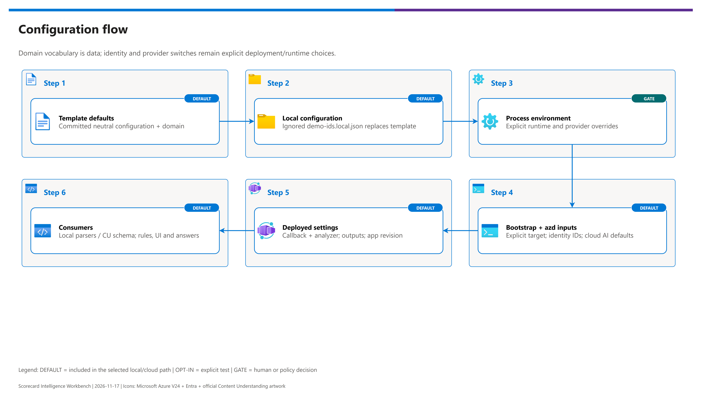
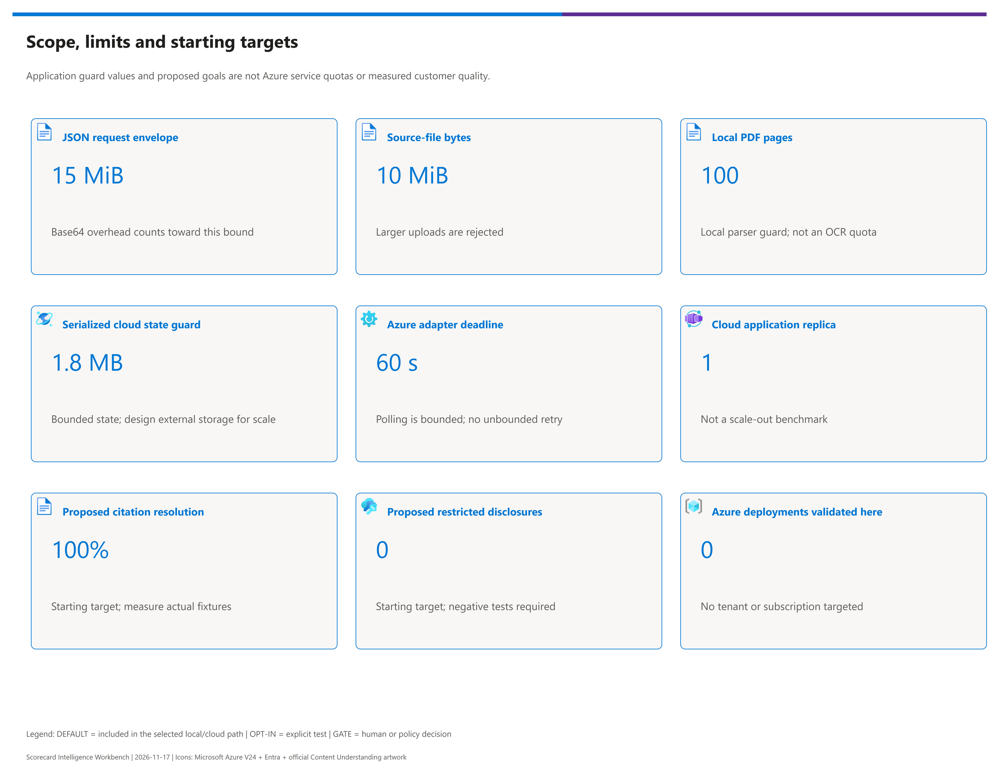

[README](../README.md) › [Reproduce](./00-reproduce-this-demo.md) › Configuration

# 08 — Configuration reference

<p>
&nbsp;
&nbsp;
&nbsp;

</p>

 

This reference inventories the operator-settable values, deployment outputs, domain fields and fixed proof-of-concept bounds. It is for anyone changing a region, measurement vocabulary, model deployment or runtime behavior. Credentials are not configuration artifacts: use managed identity in Azure and keep short-lived tokens out of files and screenshots.

## At a glance

| | Configuration surface | Purpose |
|---|---|---|
|  | `demo-ids.template.json` | Committed neutral defaults and the sole example-workload `domain` block. |
|  | `demo-ids.local.json` | Ignored local replacement and deployment-reference outputs. |
|  | azd environment | Explicit deployment inputs and generated outputs. |
|  | Process/application settings | Auth, state and provider selection. |

## Configuration flow and precedence

[](./assets/configuration-flow.png)

<sub>Editable source: [configuration flow](./assets/configuration-flow.drawio).</sub>

| Scope | Precedence / consumption | Important distinction |
|---|---|---|
| Local file loading | Existing `demo-ids.local.json`, otherwise `demo-ids.template.json` | The local file replaces the template object; it is not a recursive merge. |
| Runtime service selection | Explicit environment value, then supported local-file endpoint fallback, then documented default | Auth identity generally requires explicit environment, not merely an IDs file. |
| Programmatic tests | `createApp({config,store,env,fetchImpl,credential})` | Injected options isolate fixtures and mocked providers; not browser-authorized overrides. |
| Deployment | Preup/bootstrap → persisted azd values → quoted parameter substitutions → subscription wrapper → shared main Bicep | Bootstrap resolves missing explicit target/identity and cloud defaults before parameter resolution; preprovision only validates. Wrapper forwards every main parameter. |
| Hosted domain | Build packages the reviewed template `domain` | Ignored local config is not included in the container image. |
| Outputs | Uppercase Bicep outputs → azd environment / `azureOutputs` | Generated references are not user secrets or proof of a working login. |

> [!IMPORTANT]
> Keep all example-workload nouns in `domain`. Changing a label must not require changing shared parser code, route names or prompt instructions. Hosted customization must be packaged before image build.

## Target and identity environment

| Name | Default | Effect |
|---|---|---|
| `AZURE_ENV_NAME` | Required for deployment | 3–16 lowercase letters/digits, begins with a letter. |
| `AZURE_LOCATION` | `swedencentral` bootstrap default | Runtime/foundation region; explicitly review/confirm the target, override for approved supported regions. |
| `AZURE_TENANT_ID` | Required for cloud/locally enabled Azure | Expected user/service tenant; target guard input. |
| `AZURE_SUBSCRIPTION_ID` | Required for deployment/local live services | Explicit target; compared with Azure CLI account before local token use. |
| `AZURE_RESOURCE_GROUP` | `rg-${AZURE_ENV_NAME}` | Optional existing/fresh intended group name; choose a fresh group per provisioning path. |
| `AUTO_CONFIGURE_ENTRA` | `true` | Bootstrap creates/reuses owned managed API/SPA registrations for the exact tenant/subscription/environment, scope/app roles/service principals, scoped SPA preauthorization and current-operator manager assignment. `false` skips directory mutation; supply externally managed compatible identity and maintain its callback/roles explicitly. |
| `ENTRA_AUDIENCE` | Bootstrap-generated/reused API application GUID | Expected `aud` in v2 access tokens; not the SPA client ID or scope URI. External identity requires automation opt-out. |
| `ENTRA_CLIENT_ID` | Bootstrap-generated/reused public SPA GUID | Public browser client identity; never a client secret. Separate from `AZURE_CLIENT_ID`. |
| `ENTRA_API_SCOPE` | Bootstrap `api://<ENTRA_AUDIENCE>/access_as_user` | Browser requests this scope; API requires its final scope-name segment in `scp`. Existing supported scopes remain reusable. Custom verified-domain identifiers are not supported by this deployment guard. |
| `ENTRA_ISSUER` | Required in Entra runtime | Tenant-specific HTTPS issuer; cloud template supplies it. |
| `ENTRA_JWKS_URI` | Tenant-specific Microsoft discovery keys URL | Optional trusted signing-key endpoint; do not point at user input. |
| `AZURE_CLIENT_ID` | Generated runtime identity client ID | Select user-assigned managed identity for service access. |
| `AUTH_MODE` | Local on trusted workstation; Entra in production/Azure | `local` or `entra`; cloud refuses synthetic local auth. |

Core authentication checks the actual CLI context before acquiring local Azure credentials. Setting a diagnostic environment variable to a desired tenant/subscription is not proof of that context.

## Platform and default AI deployment inputs

| azd / process name | Bicep parameter | Default / effect |
|---|---|---|
| `CONTAINER_IMAGE` | `containerImage` | Public bootstrap image; build/deploy replaces it with the workbench. |
| `COSMOS_DATABASE` | `cosmosDatabaseName` | `workbench`. |
| `COSMOS_CONTAINER` | `cosmosContainerName` | `state`, partition key `/id`. |
| `COSMOS_THROUGHPUT` | `cosmosThroughput` | `400`; multiple of 100, at least 400 for this provisioned-throughput template. |
| `LOG_RETENTION_DAYS` | `logRetentionDays` | `30`; script validates 30–730. |
| `DEPLOY_CONTENT_UNDERSTANDING` | `deployContentUnderstanding` | `true`; creates dedicated AIServices S0 extraction resource, two model deployments and scoped runtime/setup roles. `false` explicitly opts out. |
| `CONTENT_UNDERSTANDING_LOCATION` | `contentUnderstandingLocation` | Empty → `location`; use a supported extraction/model region with residency approval. |
| `CONTENT_UNDERSTANDING_ANALYZER_ID` | `contentUnderstandingAnalyzerId` | `document_metrics`; operator-chosen custom analyzer. Use a new ID after domain/schema/model changes; no automatic replacement. |
| `CONTENT_UNDERSTANDING_COMPLETION_MODEL` | `contentUnderstandingCompletionModelName` | `gpt-5.2`; compatible completion model on the dedicated extraction account. |
| `CONTENT_UNDERSTANDING_COMPLETION_MODEL_VERSION` | `contentUnderstandingCompletionModelVersion` | `2025-12-11`; verify lifecycle and regional availability before provisioning. |
| `CONTENT_UNDERSTANDING_COMPLETION_DEPLOYMENT` | `contentUnderstandingCompletionDeploymentName` | `document-completion`; completion deployment, distinct from model name. |
| `CONTENT_UNDERSTANDING_COMPLETION_DEPLOYMENT_SKU` | `contentUnderstandingCompletionDeploymentSku` | `GlobalStandard`; check residency policy and subscription quota. |
| `CONTENT_UNDERSTANDING_COMPLETION_CAPACITY` | `contentUnderstandingCompletionCapacity` | `1`, positive; deployment-specific units and quota. |
| `CONTENT_UNDERSTANDING_EMBEDDING_MODEL` | `contentUnderstandingEmbeddingModelName` | `text-embedding-3-large`; separate from completion and answers. |
| `CONTENT_UNDERSTANDING_EMBEDDING_MODEL_VERSION` | `contentUnderstandingEmbeddingModelVersion` | `1`; verify current lifecycle and availability. |
| `CONTENT_UNDERSTANDING_EMBEDDING_DEPLOYMENT` | `contentUnderstandingEmbeddingDeploymentName` | `document-embedding`; embedding deployment on the extraction account. |
| `CONTENT_UNDERSTANDING_EMBEDDING_DEPLOYMENT_SKU` | `contentUnderstandingEmbeddingDeploymentSku` | `GlobalStandard`; check availability/quota separately from completion. |
| `CONTENT_UNDERSTANDING_EMBEDDING_CAPACITY` | `contentUnderstandingEmbeddingCapacity` | `1`, positive; deployment-specific units and quota. |
| `CONTENT_UNDERSTANDING_SETUP_PRINCIPAL_ID` | `contentUnderstandingSetupPrincipalId` | Bootstrap automatically resolves/persists the actual Azure CLI user's object ID when absent; intentionally supplied nonzero GUID overrides it. Receives Cognitive Services User for data-plane setup, not an automatic directory role. No manual input required for the default user flow. |
| `CONTENT_UNDERSTANDING_SETUP_PRINCIPAL_TYPE` | `contentUnderstandingSetupPrincipalType` | Bootstrap resolves `User` with the CLI operator; override only to match an intentionally supplied setup caller. Allowed `User`, `ServicePrincipal`, `Group`. |
| `AZURE_PRINCIPAL_ID`, `AZURE_PRINCIPAL_TYPE` | Legacy/manual-script fallback only | Reserved azd principal substitutions are not the authoritative CU setup caller. Shared settings retain these as compatibility fallback when the dedicated setup settings are absent. Prefer the dedicated settings above; Azure CLI and azd can use different users in the same tenant. |
| `DEPLOY_OPENAI` | `deployOpenAI` | `true`; separate Responses account/deployment and runtime role. `false` explicitly opts out. |
| `AZURE_OPENAI_LOCATION` | `openAILocation` | Empty → `location`. |
| `AZURE_OPENAI_MODEL_NAME` | `openAIModelName` | `gpt-5.2`; separate answer model account, not extraction reuse. |
| `AZURE_OPENAI_MODEL_VERSION` | `openAIModelVersion` | `2025-12-11`; verify current lifecycle and availability. |
| `AZURE_OPENAI_DEPLOYMENT` | `openAIDeploymentName` | `answers`; deployment name used by Responses. |
| `AZURE_OPENAI_DEPLOYMENT_SKU` | `openAIDeploymentSku` | `GlobalStandard`; regional availability and quota remain prerequisites. |
| `AZURE_OPENAI_CAPACITY` | `openAICapacity` | `1`, positive; units/cost depend on selected deployment. |
| `AZURE_ENV_NAME` | `environmentName` | Required validated resource naming suffix. |
| `AZURE_LOCATION` | `location` | `swedencentral` bootstrap default, explicitly reviewed/overridable. |
| `AZURE_TENANT_ID` | `tenantId` | Required tenant. |
| `ENTRA_AUDIENCE` | `entraAudience` | Required intended audience, populated by bootstrap or compatible existing configuration. |
| `ENTRA_CLIENT_ID` | `entraClientId` | Required public SPA client ID, populated by bootstrap or compatible existing configuration. |
| `ENTRA_API_SCOPE` | `entraApiScope` | Required full delegated API scope, populated by bootstrap or compatible existing configuration. |
| `AZURE_RESOURCE_GROUP` | `resourceGroupName` | Wrapper-only; defaults to neutral `rg-` name. |

The last row is a wrapper parameter rather than a main-template parameter. Every main parameter is passed through. Boolean and integer substitutions are quoted in `infra/azd.parameters.json` so the file is valid JSON before azd substitutes values.

> [!IMPORTANT]
> Model snapshot checked November 17, 2026: `gpt-5.2` version `2025-12-11` and `text-embedding-3-large` version `1` are the shipped defaults; all three deployments use `GlobalStandard` and capacity `1`. Capacity `1` is an adjustable low-demo choice, **not Microsoft sizing guidance or a throughput/quota guarantee**. The published retirement schedule lists June 8, 2027 for this completion version and February 9, 2028 for this embedding version. Recheck [CU supported models/limits](https://learn.microsoft.com/en-us/azure/ai-services/content-understanding/service-limits), [model deployment requirements](https://learn.microsoft.com/en-us/azure/ai-services/content-understanding/concepts/models-deployments), [Foundry model availability](https://learn.microsoft.com/en-us/azure/foundry/foundry-models/concepts/models-sold-directly-by-azure) and the [retirement schedule](https://learn.microsoft.com/en-us/azure/foundry/openai/concepts/model-retirement-schedule) before deployment. Availability does not imply subscription quota or approved GlobalStandard data processing.

The dedicated `CONTENT_UNDERSTANDING_SETUP_PRINCIPAL_ID` / `CONTENT_UNDERSTANDING_SETUP_PRINCIPAL_TYPE` are persisted before azd parameter resolution so extraction setup permission follows the actual Azure CLI caller, even when azd is signed in as another user in the same approved tenant. Do not copy azd's reserved principal value into them without confirming who will actually run analyzer setup. Neither identity nor quota authority is broadened by this distinction.

## Runtime environment

| Name | Default / source | Effect |
|---|---|---|
| `HOST` | `127.0.0.1` locally; `0.0.0.0` in container | Bind address; synthetic local auth remains loopback-only. |
| `PORT` | `3000` for `npm start`; launcher/cloud `8080` | HTTP port. |
| `NODE_ENV` | Launcher development / cloud production | Production detection forces secure auth expectations. |
| `STATE_FILE` | `data\state.json`, relative to repository | Atomic local JSON path; keep ignored and isolate tests. |
| `STATE_PROVIDER` | Automatic by endpoint; local launcher forces `local` | `local` or `cosmos`; local forces JSON even when a prior deployment left a Cosmos endpoint in the reference file. Cloud rejects local state; explicit Cosmos requires its endpoint. |
| `COSMOS_ENDPOINT` | Environment, otherwise `cosmosEndpoint` | Select Cosmos instead of JSON; requires valid Azure credentials. |
| `COSMOS_DATABASE` | `workbench` | Runtime database name. |
| `COSMOS_CONTAINER` | `state` | Runtime container name. |
| `EXTRACTION_PROVIDER` | `local` for rehearsal; `azure` in default cloud deployment | `local` or `azure`; Azure routes supported unstructured sources to the custom Content Understanding analyzer, labeled `azure-content-understanding`. Native XLSX/CSV/JSON remain accurately labeled local direct parsing. |
| `ANSWER_PROVIDER` | `local` for rehearsal; `azure` in default cloud deployment | `local` or `azure`; local is deterministic, not an LLM. |
| `CONTENT_UNDERSTANDING_ENDPOINT` | Environment, then file `contentUnderstandingEndpoint` | HTTPS extraction origin, normally `https://<custom-subdomain>.cognitiveservices.azure.com`; no credentials/query allowed. |
| `CONTENT_UNDERSTANDING_ANALYZER_ID` | Environment, then file `contentUnderstandingAnalyzerId` | Custom schema analyzer; template default `document_metrics`. Runtime never substitutes a prebuilt layout analyzer. |
| `CONTENT_UNDERSTANDING_COMPLETION_MODEL` | Environment, then file `contentUnderstandingCompletionModel` | Supported model name used in the analyzer and request mapping; not the deployment name. |
| `CONTENT_UNDERSTANDING_COMPLETION_DEPLOYMENT` | Environment, then file `contentUnderstandingCompletionDeployment` | Actual completion deployment mapped from that model name. |
| `CONTENT_UNDERSTANDING_EMBEDDING_MODEL` | Environment, then file `contentUnderstandingEmbeddingModel` | Supported embedding model name; kept separate from completion and answer models. |
| `CONTENT_UNDERSTANDING_EMBEDDING_DEPLOYMENT` | Environment, then file `contentUnderstandingEmbeddingDeployment` | Actual embedding deployment on the extraction account. |
| `AZURE_OPENAI_ENDPOINT` | Environment, then file `modelEndpoint` | HTTPS model resource origin. |
| `AZURE_OPENAI_DEPLOYMENT` | Environment, then file `modelDeployment` | Exact deployment for `/openai/v1/responses`. |
| `APPLICATIONINSIGHTS_CONNECTION_STRING` | Deployment output | Exposed for telemetry integration; resource/settings existence is not SDK instrumentation. |
| `CONTAINER_APP_NAME`, `WEBSITE_SITE_NAME`, `IDENTITY_ENDPOINT`, `MSI_ENDPOINT` | Platform-generated | Cloud detection signals, not safe operator switches for bypassing auth. |
| `ComSpec` | Windows platform default command interpreter | Used to invoke Azure CLI context check; not a deployment target. |

`AZURE_TENANT_ID`, `AZURE_SUBSCRIPTION_ID`, `AZURE_CLIENT_ID` and the Entra settings above are also consumed by the runtime. Local live-provider startup validates the intended tenant/subscription before `DefaultAzureCredential` use. Managed identity in Azure does not trigger an interactive login. Public `/api/auth/config` exposes only the intended browser `authMode`, `tenantId`, `clientId`, `scope` and fixed `redirectPath: /auth/callback`; the callback serves the UI, not protected source data. Configure that exact HTTPS URI as platform SPA. Browser access tokens remain in memory; no client secret or platform token store is configured.

The six Content Understanding settings are also consumed by `scripts/configure-content-understanding.mjs`. The postprovision/shared manual path runs setup after writing local IDs, using the operator identity rather than an inherited runtime `AZURE_CLIENT_ID`. Setup reads resource model defaults, merges only missing mappings, and creates the domain-derived custom analyzer using GA `2025-11-01`. A conflicting existing mapping or analyzer is an error, never an automatic overwrite. Runtime sends the explicit model-name → deployment-name map per analysis. Model/version/SKU choices still require deployment-time verification; no preview agentic feature is selected.

## Domain configuration — only workload-specific surface

| Key | Default meaning | Validation / consumer |
|---|---|---|
| `domain._note` | Explanatory comment | Human-readable only. |
| `domain.title` | Neutral workbench display title | Required string; session/UI. |
| `domain.entityLabel` | Neutral entity noun | UI display; does not change stable API field names. |
| `domain.period` | Example review period | `YYYY-MM`; default upload/review scope. |
| `domain.rulesVersion` | Explicit rules revision; absent → `unversioned` | Session and frozen published snapshot. |
| `domain.toolName` | Neutral evidence-tool identity | Configurable descriptive metadata; not authorization. |
| `domain.toolDescription` | Neutral authorized-evidence description | Descriptive metadata; does not create an external agent tool. |
| `domain.confidenceThreshold` | `0.9` in template | Review-routing threshold; not a probability guarantee. |
| `domain.acceptedFileTypes` | Template: `.pdf`, `.xlsx`, `.csv`, `.txt`, `.json`, `.png`, `.jpg`, `.jpeg`, `.tif`, `.tiff`, `.bmp`, `.docx`, `.pptx`, `.html`, `.md`, `.eml`, `.msg` | Upload allowlist; local UI offers only `.pdf`, `.xlsx`, `.csv`, `.txt`, `.json`. XLSX/CSV/JSON stay local even when cloud extraction is configured. A config entry cannot add an unimplemented format. |
| `domain.kpis` | Configured measurement list | At least one ordered valid KPI rule required. |
| `domain.kpis[].id` | Stable neutral identifier | Required, unique; persists in records. |
| `domain.kpis[].name` | Display label | Required; extraction mapping and UI. |
| `domain.kpis[].aliases` | Source label synonyms | Parser normalization, including alternate languages. |
| `domain.kpis[].unit` | Expected unit | Numeric interpretation and display. |
| `domain.kpis[].direction` | `higher`, `lower` or `annual_cumulative` | Chooses ordered thresholds or explicit annual-limit assessment. |
| `domain.kpis[].target` | Configured target boundary | Finite number; ordered against watch/warning. |
| `domain.kpis[].watch` | Configured watch boundary | Higher direction: target ≥ watch ≥ warning. |
| `domain.kpis[].warning` | Configured warning boundary | Lower direction: target ≤ watch ≤ warning. |
| `domain.kpis[].internalBaseline` | Optional `{value, unit, provenance, synthetic}` object | Separate internal reference; not the source's rating or configured status. |
| `domain.kpis[].internalBaseline.value` | Explicit finite baseline value | Arithmetic gap is reported value minus this value, in the same unit. |
| `domain.kpis[].internalBaseline.unit` | Optional explicit comparison unit | If supplied, must equal the record/KPI unit; mismatch means no comparable gap, never an implicit conversion. |
| `domain.kpis[].internalBaseline.provenance` | Baseline source/definition | Preserve provenance; do not imply an unverified organizational benchmark. |
| `domain.kpis[].internalBaseline.synthetic` | Explicit boolean | Synthetic reference values remain labeled synthetic. |
| `domain.kpis[].ruleType` | Optional `annual_cumulative` alternative | Can select annual handling with a compatible lower-direction rule. |
| `domain.kpis[].annualLimit` | Required finite value for annual rules | No default annual limit is invented. |
| `domain.kpis[].accumulation` | `reported_ytd` or `monthly_sum`, required for annual rules | Use a source-reported total or require complete unique monthly evidence. |

Do not add example-domain nouns anywhere else. After retargeting, regenerate synthetic files and rerun domain-isolation tests. A rules change requires a new `rulesVersion`; published snapshots retain the earlier rules and version.

The committed example explicitly marks its names, values, thresholds, annual limit and internal baselines as synthetic—not approved organizational policy. Read their exact current values from `demo-ids.template.json`; this reference deliberately does not maintain a second copy of workload configuration.

`customerRating` / `sourceRating` are extracted record fields, not status overrides. CSV/XLSX use a `Customer rating` header; JSON can supply either field. `baselineComparison` is a derived object: missing comparable input yields `available=false` and `gap=null`. `assessment` records the rule explanation and evidence IDs. For `monthly_sum`, a missing, duplicated or uncertain month makes the annual assessment incomplete; it never becomes a fabricated total.

## Local reference file and output mapping

| Local key | Source / behavior |
|---|---|
| `_template`, `_note` | Template marker and distribution guidance; writer changes `_template` to false. |
| `domain` | Preserved exactly by output writer; local replacement supplies the complete domain. |
| `tenantId`, `subscriptionId` | Explicit deployment target snapshot; not a substitute for runtime auth environment. |
| `resourceGroup` | `AZURE_RESOURCE_GROUP`. |
| `appUrl` | `SERVICE_APP_ENDPOINT_URL`. |
| `cosmosEndpoint` | `COSMOS_ENDPOINT`, runtime file fallback. |
| `cosmosDatabase`, `cosmosContainer` | Reference names; runtime explicit environment/default still governs. |
| `contentUnderstandingEndpoint` | `CONTENT_UNDERSTANDING_ENDPOINT`, empty if disabled. |
| `contentUnderstandingAnalyzerId` | `CONTENT_UNDERSTANDING_ANALYZER_ID`; template `document_metrics`, deployment output empty if disabled. |
| `contentUnderstandingCompletionModel`, `contentUnderstandingCompletionDeployment` | `CONTENT_UNDERSTANDING_COMPLETION_MODEL`, `CONTENT_UNDERSTANDING_COMPLETION_DEPLOYMENT`; exact model-name/deployment-name mapping. |
| `contentUnderstandingEmbeddingModel`, `contentUnderstandingEmbeddingDeployment` | `CONTENT_UNDERSTANDING_EMBEDDING_MODEL`, `CONTENT_UNDERSTANDING_EMBEDDING_DEPLOYMENT`; separate embedding mapping. |
| `modelEndpoint`, `modelDeployment` | `AZURE_OPENAI_ENDPOINT`, `AZURE_OPENAI_DEPLOYMENT`. |
| `managedIdentityClientId` | `AZURE_CLIENT_ID`, reference only; runtime uses environment. |
| `entraAudience` | Approved audience snapshot; runtime requires `ENTRA_AUDIENCE`. |
| `entraClientId`, `entraApiScope` | Public SPA and delegated-scope snapshots; runtime uses `ENTRA_CLIENT_ID` / `ENTRA_API_SCOPE`. |
| `azureOutputs` | Complete uppercase deployment output map below. |

| Output | Meaning |
|---|---|
| `AZURE_LOCATION`, `AZURE_TENANT_ID`, `AZURE_RESOURCE_GROUP` | Target and resource-group references. |
| `ENTRA_CLIENT_ID`, `ENTRA_API_SCOPE` | Public SPA client and full delegated scope. No secret output. |
| `AZURE_CONTAINER_REGISTRY_NAME`, `AZURE_CONTAINER_REGISTRY_ENDPOINT` | Remote build and image-pull registry. |
| `AZURE_CONTAINER_APPS_ENVIRONMENT_ID` | Hosted environment resource ID. |
| `AZURE_CONTAINER_APP_NAME`, `SERVICE_APP_RESOURCE_NAME` | Application resource name and azd service mapping. |
| `SERVICE_APP_ENDPOINT_URL` | HTTPS app endpoint. |
| `AZURE_CLIENT_ID`, `AZURE_MANAGED_IDENTITY_ID`, `AZURE_MANAGED_IDENTITY_PRINCIPAL_ID` | Runtime identity references. |
| `COSMOS_ACCOUNT_NAME`, `COSMOS_ENDPOINT`, `COSMOS_DATABASE`, `COSMOS_CONTAINER` | Persistent-state resource bindings. |
| `CONTENT_UNDERSTANDING_ENDPOINT`, `CONTENT_UNDERSTANDING_ANALYZER_ID` | Default cloud extraction endpoint and custom analyzer ID. |
| `CONTENT_UNDERSTANDING_COMPLETION_MODEL`, `CONTENT_UNDERSTANDING_COMPLETION_DEPLOYMENT` | Default cloud extraction completion model and deployment. |
| `CONTENT_UNDERSTANDING_EMBEDDING_MODEL`, `CONTENT_UNDERSTANDING_EMBEDDING_DEPLOYMENT` | Default cloud extraction embedding model and deployment. |
| `CONTENT_UNDERSTANDING_ACCOUNT_NAME`, `CONTENT_UNDERSTANDING_ACCOUNT_ID` | Dedicated extraction account references; all Content Understanding outputs are empty when disabled. |
| `AZURE_OPENAI_ENDPOINT`, `AZURE_OPENAI_DEPLOYMENT` | Default cloud answer-provider endpoint and deployment. |
| `APPLICATIONINSIGHTS_CONNECTION_STRING`, `LOG_ANALYTICS_WORKSPACE_ID` | Telemetry resource references; sanitize diagnostics. |

## Script parameters and tooling environment

| Script | Parameters / variables | Default / purpose |
|---|---|---|
| `scripts/deploy.ps1` | `-TenantId`, `-SubscriptionId`, `-EnvironmentName`, `-Location`, `-EntraAudience`, `-ResourceGroup` | Respective `AZURE_*` / `ENTRA_AUDIENCE` environment values; invokes shared bootstrap, verifies the explicit target, initializes identity and default-on AI, then deploys and configures the analyzer/callback. |
| `scripts/deploy.ps1` | `-Manual` | False; true selects imperative resource operations instead of shared Bicep deployment. |
| `infra/hooks/preup.ps1`, `infra/hooks/bootstrap.ps1` | `Initialize-WorkbenchDeployment -PersistAzd`; target environment values and the identity/model settings above | Prompt only for missing target values, verify/login to intended CLI tenants, persist azd inputs before template parameter resolution. Explicit existing values, including AI opt-outs, are preserved. |
| `infra/hooks/identity.ps1` | `Initialize-WorkbenchIdentity -Settings -SubscriptionId`; `Complete-WorkbenchIdentity -Settings -AppUrl` | Initialize/reuse API/SPA, scope/roles/service principals and current-operator manager; merge exact HTTPS callback preserving existing URIs. `AUTO_CONFIGURE_ENTRA=false` skips directory changes. |
| `infra/hooks/preprovision.ps1` | Validated deployment settings | Strict read-only configuration/context validation; the planning command does not create directory applications. |
| `infra/hooks/postprovision.ps1` | Deployment outputs and initialized settings | Persist local outputs, configure extraction defaults/analyzer and exact SPA callback. |
| Bootstrap interaction | `AZD_NON_INTERACTIVE`, `CI` | Either set to `true` disables interactive target/login prompts; automation must supply explicit target/authentication. |
| `scripts/start-local.ps1` | `-Port` | 8080, range 1–65535. |
| `scripts/start-local.ps1` | `-ExtractionProvider`, `-AnswerProvider` | `local`; only `local` or `azure`. |
| `scripts/start-local.ps1` | `-TenantId`, `-SubscriptionId` | Required and verified when either provider is Azure. |
| `scripts/configure-content-understanding.mjs` | Six Content Understanding runtime settings above; `AZURE_TENANT_ID`, `AZURE_SUBSCRIPTION_ID` | Data-plane setup reads local IDs or template; explicit environment overrides file. Context verification is mandatory before operator token acquisition. |
| `scripts/export_diagrams.py` | paths, `--scale`, `--border`, `--check`; `DRAWIO_EXE`, `LOCALAPPDATA` | Scale 2, border 20; executable override or installed desktop discovery. |
| `scripts/lint_doc_visuals.py` | `--root`, `--strict`, `--quiet`, `--no-diagram` | Root current directory; strict treats warnings as failures. No exemptions used here. |
| `scripts/make_badges.py` | output, `--version`, repeated `--badge`, `--no-standard` | Local SVG generation; custom `name:label:value:#color`. |
| Browser test harness | `PLAYWRIGHT_CHANNEL`, `CAPTURE_EVIDENCE` | Edge by default; `CAPTURE_EVIDENCE=1` writes sanitized local evidence screenshots. |
| Browser isolated runtime | `PLAYWRIGHT_PORT`, `WORKBENCH_BROWSER_STATE` | Test server port (default 4387) and isolated test-state file; never share rehearsal/cloud state. |
| Operator API examples | `WORKBENCH_ACCESS_TOKEN` | Short-lived bearer secret only in current process; never committed/configured in app. |

`generate-samples.mjs` and `evaluate.mjs` use the repository configuration and produce local synthetic artifacts/results. They do not authenticate Azure or use private source files. All shipped Python documentation tools use only the Python standard library; no Python package installation is required. The no-argument `scripts/deploy.ps1` prompts for missing approved target values through the same bootstrap; it runs `npm ci` only if required application dependencies are absent.

## Fixed POC bounds — not environment knobs

[](./assets/scope-and-targets.png)

<sub>Editable source: [scope infographic](./assets/scope-and-targets.drawio).</sub>

| Bound | Implemented value | Consequence |
|---|---|---|
| JSON request envelope | 15 MiB | Base64 overhead counts toward the request. |
| Source bytes | 10 MiB | Reject larger files; do not silently truncate. |
| Local PDF pages | 100 | Bounded local parse; not an Azure service limit. |
| Serialized cloud state | 1.8 MB guard | Source bytes share the bounded state envelope. |
| Azure adapter deadline / poll | 60 seconds / 1 second | No unbounded polling; no automatic retry claim. |
| Custom-analyzer CLI role propagation | 180 seconds, HTTP 403 only | Bounded setup retry; defaults/schema conflicts fail without automatic replacement. Not a runtime analysis retry policy. |
| HTTP request / header timeout | 90 seconds / 15 seconds | Request-driven POC, not durable background processing. |
| Local role session | 8 hours, bounded session cache | Synthetic rehearsal only. |
| Browser PKCE transaction | 10 minutes; single use | State/verifier transaction only in `sessionStorage`; removed before callback validation/redemption. No access token is stored there. |
| Browser access token | Memory only; 30-second expiry margin | No refresh token or silent refresh. Reload/expiry requires sign-in again; explicit sign-out clears auth state. |
| Local session / audit cache | 1000 entries each | Not a durable compliance audit product. |
| Azure application | One replica | Not a tested scale-out design. |

> [!WARNING]
> Increasing constants is not a scaling strategy. External source storage, async extraction, tenancy, retention and recovery need a separate design. Model and Azure service quotas are additional independent limits.

## Common recipes

<details><summary><b>Local deterministic rehearsal</b></summary>

```powershell
.\scripts\start-local.ps1 -Port 8080 -ExtractionProvider local -AnswerProvider local
```

</details>

<details><summary><b>Change domain without changing shared code</b></summary>

Copy the template into the ignored local file, replace the complete `domain` labels/KPIs/aliases/units/thresholds, set a new `rulesVersion`, regenerate samples and run tests. For a hosted image, package the reviewed domain into the build template first. Do not place organizational files or populated IDs in the build context.

</details>

<details><summary><b>Explicitly opt out for an extraction-only cloud deployment</b></summary>

```powershell
azd env set DEPLOY_CONTENT_UNDERSTANDING true
azd env set DEPLOY_OPENAI false
# Default bootstrap supplies models, identity and setup; target verification,
# directory permission and extraction quota are still mandatory.
azd up
```

The [deployment recipe](./03-deployment.md#phase-4--review-default-extraction-and-answers) documents overrides for **both** completion and embedding model/version/deployment/SKU/capacity settings, separate from the answer model. Both switches are `true` when omitted; the recipe above deliberately deviates from the complete default demo. Verify current [Content Understanding models](https://learn.microsoft.com/en-us/azure/ai-services/content-understanding/concepts/models-deployments), [Responses support](https://learn.microsoft.com/en-us/azure/ai-services/openai/how-to/responses) and [model retirement](https://learn.microsoft.com/en-us/azure/foundry/openai/concepts/model-retirement-schedule) rather than copying a stale pin.

An older azd environment may retain explicit `false` values. To migrate it to the full footprint, set both `DEPLOY_CONTENT_UNDERSTANDING` and `DEPLOY_OPENAI` to `true` before `azd up`; bootstrap deliberately preserves explicit settings rather than overriding your opt-out.

</details>

Next: [Reproduce the complete workflow](./00-reproduce-this-demo.md).

*Last updated: 2026-11-17*
